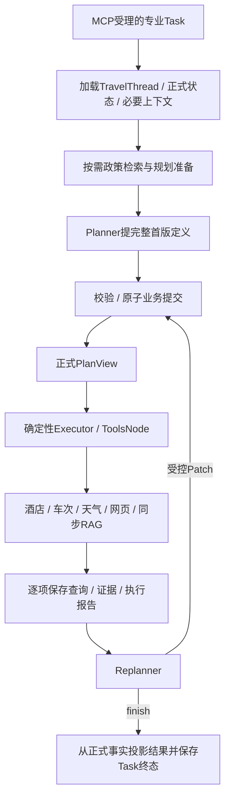

# Agent领域、数据、记忆与RAG

版本：2026-11-06架构基线v1。返回[总览](README.md)。本文是原[Agent Design](../../openspec/changes/refactor-agent-kernel-plan-execute/design.md)、[组件契约](../../openspec/changes/refactor-agent-kernel-plan-execute/contracts/README.md)及[RAG Design](../../openspec/changes/refactor-rag-mcp-retrieval-service/design.md)的阅读投影。旧领域DTO可复用，跨服务传输和物理表映射须按本版复核，不能以旧JSON夹具通过代替运行协议验收。

## 1. 双入口与能力边界

General和差旅助手是两个用户会话入口，不是两个用户身份。入口可普通对话、读写允许设置、网页搜索及直接查询；需要建立/修改正式安排才委派同一Travel专业能力。差旅入口不先绕General，不因工具调用数量多就强制建计划。

平台保存入口上下文、相关计划目录/摘要和真实专业结果。目录由正式状态投影，不另建事实表；只注入本轮相关项，不无界复制所有完整计划。模型判断新建/继续及合理目标，程序校验对象存在、归属、计划线程关系和当前版本。

直接查询转规划时携带必要上下文和真实证据引用，复用须检查输入、来源、模式、时效和授权。未知价格为null，不作零；供应方仅能查地点就不宣称能报价/预订。没有必需日期/人数时不发猜测参数，可形成已知范围的最小计划并说明未知。

## 2. Travel内部编排



沿用Eino v0.9.0-beta.1，AgentAsTool作为入口专业能力表达；专业内部以Plan-Execute/LoopAgent组织Planner、确定性自定义Executor和Replanner。外层异步中断需适配原工具调用定向恢复，不把远端accepted当工具最终结果。

2026-11-06已通过隔离实验核验轻量桥Agent中断、最外层完整checkpoint及ResumeWithParams定向恢复，实际PG联合提交仍待实现。用户确认Travel最多8个“Executor＋Replanner”轮次，连续2轮无正式计划、有效证据或选择的实质变化即返回已有结果/未完成原因，恢复不清零；初始Planner不算一轮，网络重试不算新的规划轮次。

固定的数据转换、校验、提交和投影尽量用Chain/Lambda；工具分派复用ToolsNode。Lambda调用领域Service/Repository，框架节点成功或SessionValues提案不代表正式业务已提交。Executor从已提交Task展开查询，不再加一次模型工具选择；各内部角色不各起服务或Topic。

## 3. 上下文与计划身份

一份TripPlan对应一个持续TravelThread。首次委派只给当前目标所需的父上下文快照及来源；继续时加载原TravelThread历史，加本次用户新要求和必要主线程增量。新计划建立新工作线程，恢复/修订不重建原线程。

平台根Thread与Travel计划线程分属不同业务上下文，不复制全部历史，不因为共用用户就跨会话授权。Thread给语义上下文，checkpoint给执行位置，计划/证据/操作回执给正式事实，三者不能互相替代。

## 4. 计划模型与局部重查

| 对象 | 职责 |
| --- | --- |
| Stop | 一次停留/端点；同城市再次到访也有不同稳定ID |
| Leg | 前后Stop的交通关联 |
| Task | 完整查询定义、目标引用、参数、适用要求和排序 |
| Item | 一个查询动作及真实数据依赖，不复制参数，不是select动作 |
| requirement | 内容、范围、单位及真实来源，政策＞用户＞记忆 |
| selection | 对当前Task版本真实候选的选择及依据 |
| PlanView | 从正式快照和执行记录投影needs_query等状态 |

初期以版本化JSONB保存完整定义/快照，不按每个Stop/Item扩一组可随意修改的明细表。Planner只提出定义；ID、版本、执行状态和候选真实性由程序控制。

Task有效定义变化使该Task下全部查询Item重查；关联路线和适用要求也参与有效定义。无关Task不因全局plan_revision增长失效。选择候选可形成新内容修订，但不增加Task查询定义版本；显式refresh增加执行generation，不伪造定义变化。

独立查询可以并行，depends_on只表达实际数据依赖，不按行程先后强制串行。旧结果可留审计，但迟到旧task_revision/generation不能满足当前查询或成为当前选择。

## 5. Patch与业务提交

首版完整创建，后续用稳定ID的add/update/remove/reorder、set_selection/clear_selection、refresh_queries等业务操作。expected_revision保护当前版本；变化采用受限字段路径的set/unset，缺省、null和删除分开，不接受任意JSON Pointer或数组下标。

先在私有副本顺序应用整份Patch，再校验完整引用图、结构、来源、候选与归属，任一错误不部分提交。删除引用对象要求同Patch处理引用方，不静默级联。正式快照/版本指针、执行安排和actions成功结果在Travel本地事务一致保存。

同operation_id同参数返回原成功结果；不同参数拒绝。业务提交后未返回而崩溃，恢复读actions结果，不重复增加修订或副作用。不再新建独立travel_decisions或第二份回执事实；旧表保留历史，必要依据在actions/revisions/事件中可追溯。

模型负责整体规划和取舍，不再按hard/soft标签做候选业务过滤；程序仍严格保护结构、参数、版本、真实引用和权限。工具status与coverage、专业call_status与用户目标完成程度分开，失败、无结果、未知和部分完成不混成空成功。

## 6. 数据所有权

| 数据组 | 平台 | Travel | 共享/传递方式 |
| --- | --- | --- | --- |
| 用户/登录/设置 | 权威管理 | 只接受已核验业务范围 | 服务身份与执行授权，不转发Cookie |
| 会话/入口消息/Run | 权威管理 | 保存必要的委派关联 | 不直接写平台业务表 |
| Job/现场 | 平台入口Job及checkpoint | 专业Task及自身checkpoint | Delegation映射，不跨服务业务FK |
| 专业计划/修订/动作 | 受控读取投影 | 权威管理 | 经MCP/受控接口返回正式结果 |
| 查询调用/证据 | 入口直接查询由平台保存 | 专业查询由Travel保存 | 不可变内容/来源引用，授权及当前版本核对 |
| 长期记忆 | 用户统一快照及维护 | 按需使用授权相关投影 | 不维护独立可漂移偏好副本 |
| Outbox/Dispatch | 平台分发权威 | 不直接消费平台命令 | Kafka后接MCP提交 |
| 调用预算/资源许可 | 参与统一约束 | 参与统一约束 | control私有调用账及受限函数；Redis只预准入，实际事务/权限待实施验证 |

用户已选定同一PG实例、不同schema和数据权限。platform与travel独立角色/凭据，迁移与运行角色分开；运行角色不读写对方业务表。技术复核增加私有control协调schema，由受限函数管理授权guard/scope及唯一调用账；平台Session/Run变化与其guard本地同事务，Travel业务提交持相关guard锁裁决撤回竞争，不跨服务修改业务表。具体权限/锁序见原engineering-protocol 2.1，真实SQL仍待验证。旧19/23表字典不作为固定物理表数；Travel工作消息用本地线程序号，不共用平台conversation锁。

可信范围包含用户/授权主体、来源Run/委派、固定目标、deadline、预算及允许能力。新模型/工具尝试与业务提交复核当前授权；原Session撤销/过期后阻止新有效推进。跨服务授权核验与撤回传播必须在实施前落实，不把API Key存在当整个Run永久授权，也不承诺立即撤回已发远端计算。

共享模型账户仍跨进程限额。Redis Lua作快速预准入，持久调用登记/预算与资源行约束守硬上限；Redis切换丢许可不能使每副本各自满额。公共账/授权访问不等于Travel可修改平台Run、用户会话或其他任务。具体资源账表/接口、分配/结算和未知usage处理是详细契约项，不能隐含造出两份独立权威计数。

## 7. 短期摘要与长期记忆

短期沿用20,000估算token预算、80%检查、每次最多合并三个旧完整轮次；保留当前Run原文及完整工具配对。历史摘要和未覆盖近期消息不重复输入；摘要与覆盖位置以版本保护一起提交，原始消息保留。Travel工作线程有自己的历史边界，预算适配需实际验证。

当前Go旧代码与该目标策略并非完全相同，不能把设计沿用写成已实现。上下文清除、来源排除或撤回必须同时影响摘要/记忆投影，不能通过复制到子线程重新带回。

长期记忆按user统一、分领域、带来源/权威级别。用户明确记住/修改/撤回由入口模型选择确定性工具，直接提交真实结果，不等待阈值、不做关键词识别；明确重新分析可提交独立后台维护。

每个入口主Thread独立累计10轮成功有效对话，Maintenance程序认领稳定检查操作并做必要性判断；需要才调用MemoryAgent，总结可返回空updates。reviewed表示已检查，summarized表示归纳成功覆盖；无需总结推进前者，空更新成功也推进后者，失败不伪造覆盖。内部模型/工具/Item不计用户轮次，后台有独立租约/预算且不阻塞回答。

## 8. 独立RAG服务

RAG仍是同步查询工具，不是子Agent。平台/Travel经HTTP MCP取得完整证据，网络等待不持PG事务；所属执行任务继续占槽并续租。平台到RAG共享并发与RAG服务端实际检索容量分开，不能由客户端超时推断原生计算已停止。

保留四只读工具query_policy_evidence、query_knowledge_hub、list_collections、get_document_summary。HTTPS/服务API Key、工具及逻辑知识库grant逐调用核验，不传用户Cookie，不开放普通检索凭据写文档。top_k默认5/上限20、query上限4000字符、请求64KiB、完整响应1,000,000字节；超限明确错误，不截政策正文。

独立SQLite WAL管理逻辑库、文档/版本、profile、chunk sets、构建、授权和评测；原文件持久归档，首版TXT/PDF、单服务/单构建worker，已有CLI/管理界面适配。Milvus每构建独立collection，Dense/BM25同一语料与可见范围。

```text
授权 / 活动构建与profile快照 / Query编码
  → Dense 20 + BM25 20
  → 去重、RRF(k=60)，最多40候选
  → Rerank
  → 可选时间融合
  → top_k完整证据与真实路径
```

默认recursive分块1000字符/重叠200，paragraph作对照，均遵守真实tokenizer上限。Dense候选BGE-small-zh-v1.5/512维；Rerank候选bge-reranker-v2-m3，路径/revision及中文能力要核验，不把未安装模型写成可用。正常查询统一知识库混合profile，Host不指定模型/权重/物理集合。

索引queued/running/validating/ready/published，校验后本地事务CAS活动指针；查询固定build/profile/visibility并持pin。删除先tombstone及可见性修订，回退不复活删除项；物理清理等在用pin释放。两路都失败为error，两路成功无候选为no_knowledge，一路失败或Rerank失败按契约降级，返回实际路径。

时间感知保留timelyrag-adapted-v1工程设计：QIT问题时刻、QET目标、DIT首次入库、可信DET条款有效期分开；未知不冒充永久有效，无足够信号明确跳过。候选权重与公式见原RAG D7，不声称论文完整复现或已验证收益。

真实评测固定Query/时间、语料/配置/模型和gold原文范围，比较Dense/BM25/Hybrid、Rerank和时间开关；报告Recall、nDCG/MRR、错误时间版本比例、延迟与失败，不剔除失败组伪造收益。RAG正式范围不因本机先用协议模拟器而缩减。
