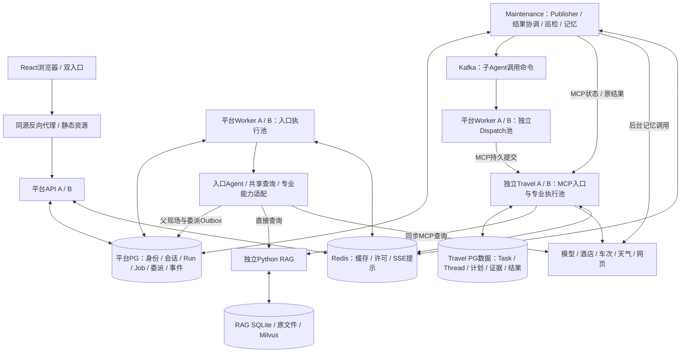

# 小豆包终极架构方案：本轮设计基线v1

日期：2026-11-06。状态：**本轮架构基线已整理，四项关键选择已由用户确认；产品尚未实现/验收。** “终极版”表示收拢本轮讨论的阅读入口，后续行为变更仍走原OpenSpec，不代表永远不可调整。

本日技术复核已对照原Agent/RAG两change及实际代码，接法和验证证据见[当前复核记录](../../openspec/changes/refactor-agent-kernel-plan-execute/engineering-review.md)。用户补充确认Travel最多8个“执行＋重新规划”轮次、连续2轮无实质进展结束。公共授权/预算采用受限control协调schema及白名单函数；业务schema仍互不开放。仅更新原设计/契约，未进入产品实施；依赖环境、详细计划与执行方式选择尚未完成。

本文档组仅整理正式设计和讨论决定，不另建需求规格。唯一正式行为在原Agent/RAG change的specs；技术决定在原design及附录，实施状态在原tasks。本目录不把建议写成用户已确认，也不把文档检查写成产品测试。

## 1. 阅读顺序

| 文档 | 内容 |
| --- | --- |
| 本文 | 总架构、进程、确认记录、参数和当前状态 |
| [01 执行与可靠性](01-runtime-and-reliability.md) | 完整交接、Outbox/offset、MCP幂等、租约/窗口、重试和巡检 |
| [02 领域、数据与RAG](02-domain-data-and-rag.md) | Agent编排、计划/Patch、数据所有权、记忆及检索服务 |
| [03 决策与备选](03-decisions-and-alternatives.md) | 本周关键取舍、少量备选及重新评估条件 |
| [04 验证与交付](04-validation-and-delivery.md) | 认证/SSE、故障矩阵、迁移、开发流程和简历证据 |

正式来源：[Agent proposal](../../openspec/changes/refactor-agent-kernel-plan-execute/proposal.md)、[Agent specs](../../openspec/changes/refactor-agent-kernel-plan-execute/specs/)、[Agent design](../../openspec/changes/refactor-agent-kernel-plan-execute/design.md)、[当前工程协议](../../openspec/changes/refactor-agent-kernel-plan-execute/mq-mcp-dispatch-protocol.md)、[tasks](../../openspec/changes/refactor-agent-kernel-plan-execute/tasks.md)；[RAG design/specs](../../openspec/changes/refactor-rag-mcp-retrieval-service/design.md)。

## 2. 已确定的架构结论

1. 双用户入口：General与差旅助手共享查询底座；纯查询免TripPlan，规划/修改/正式选择进入同一专业能力。
2. Travel独立服务进程，首版实际通过远端HTTP MCP接入；RAG仍为同步检索工具，不是子Agent。
3. 子Agent调用采用平台事务Outbox → Kafka → 平台Dispatch Worker → MCP → Travel。Kafka不直接再向Travel发另一份执行命令，外部专业服务不必理解平台消费协议。
4. 父Job可靠保存现场/依赖/Outbox后waiting、清执行租约并释放槽；取得真实结果后ready、新epoch认领恢复。Run全局deadline贯穿排队/等待/重试，不续长。
5. Outbox首版只后台轮询，无Redis Pub/Sub或其他主动唤醒。工具短重试使用本地timer，不走MQ、不需要Redis。
6. 同一逻辑可重试操作最多重试3次、总尝试4次，full jitter窗口1/2/4秒；次数/预算不因重投或恢复清零。
7. PG持有正式状态、幂等、现场、事件及调用账；Redis用于缓存/共享预准入和跨API提示，不能独占硬预算或执行权。
8. 不做活动Run补充、用户暂停/继续/整轮取消；页面断线不停止任务。2026-11-07用户确认旧数据库数据均可舍弃，新部署从空库开始，不导入旧任务或断点。

## 3. 总体连接

入口执行和Dispatch是同一平台Worker进程内可独立限流的逻辑池，不是每个图框都要一个进程。Maintenance各循环独立推进，记忆模型调用不能堵住Outbox和结果收集。Travel自己的执行权由Travel管理，平台查询状态不替它续租。

## 4. 已确认的关键配置

以下为当前采用的配置，已同步原OpenSpec。

| 编号 | 决策项 | 用户确认 | 影响 |
| --- | --- | --- | --- |
| 1 | Run默认总期限 | **300秒**，接纳时计算固定deadline | 排队、等待、退避和父汇总都计时；不会续长 |
| 2 | PG物理部署 | **同一PG实例、不同schema和数据权限** | 平台/Travel独立角色及迁移；不授予对方业务表读写权 |
| 3 | 子Task最终明确failed | **收集失败及部分结果交回父Agent，不自动新建子任务** | 父端如实处理失败；同key重提仍是原失败任务 |
| 4 | 子Agent持久延迟重试 | **PG not_before＋Outbox轮询，到期再发Kafka** | 资格、次数、下一时刻与Outbox同事务持久化；不另建ZSET闹钟 |

MCP短请求超时或Worker失联仍按原身份查询/恢复，不代表最终失败；工具短重试保持本地timer。

## 5. 进程及多实例起点

以下为代理给出的可配置工程建议，供本版整体审阅；数量不是用户逐项确认或性能结论。

| 进程 | 多实例验收建议 | 装配内容 |
| --- | --- | --- |
| 平台API | 2 | HTTP/认证/接纳/查询/SSE，不执行Agent |
| 平台Worker | 2 | entry池＋Kafka Dispatch池，容量独立；自身MCP Client复用 |
| Travel服务 | 2 | HTTP MCP Server＋专业Task池＋续租/本服务恢复 |
| Maintenance | 1 | Outbox、结果收集、全局巡检、周期记忆与MemoryAgent；多副本可扩，但需专项验证 |
| RAG | 1＋构建worker 1 | 独立检索/索引/管理库 |

平台与Travel共用一个PG实例，按schema和数据库角色隔离数据权限。Kafka本机1 broker/KRaft、业务分发Topic起步2分区、RF/minISR=1/1只用于本机集成；多副本容灾不冒充已验证。Redis日常single，1主2从/3 Sentinel/quorum2为故障专项设计，启用前核验资源/地址/配置与真实切换，不宣传同机容器能承受主机故障。

单实例可用于排障，不能替代双API/双Worker/双Travel的关键分摊与接管验收。现有单实例锁、自动迁移与stdio装配必须适配后才可多开。

## 6. 参数表与状态

| 参数 | 工程起点 | 状态/约束 |
| --- | --- | --- |
| Run总期限 | 300秒 | 用户已确认；接纳时固定，包含排队/等待/退避/父表达 |
| entry槽 | 每平台Worker 2 | 建议，2实例合计4，waiting释放 |
| Dispatch槽 | 每平台Worker 2 | 建议，只到可靠MCP提交，不占到专业任务结束 |
| Travel槽 | 每Travel实例1 | 建议，2实例合计2，工具等待继续占用 |
| 模型账户并发 | 集群2 | 建议，含同账户后台记忆，不乘副本数 |
| RAG端点并发 | 平台/Travel共同1 | 建议，区别于RAG服务端检索容量 |
| PG池 | 每Go进程最多4 | 建议，若7个Go进程则合计28，运维另留余量；不沿用旧20连接 |
| Outbox扫描 | 500～1000ms | 候选，索引批量，积压时在容量内连续处理 |
| Outbox批次/发布租约 | 100 / 30秒 | 候选，保证批次在租约内或续持，不跨网络持行锁 |
| running续租/租约 | 5秒 / 20秒 | 候选，DB时间、owner/epoch、有效期限内续；waiting无执行租约 |
| 巡检 | 1秒 | 候选，按状态/到期索引批量，非全表扫描 |
| 工具总期限 | 10秒 | 沿用候选，全部尝试/退避共用，取Run剩余时间最小值 |
| 三次退避 | U(0,1s) / U(0,2s) / U(0,4s) | 已确认方向，Retry-After/剩余deadline可提早停止 |
| Travel规划循环 | 最多8轮，连续2轮无实质进展结束 | 用户本日确认；计数持久化，恢复不清零，保留真实部分结果 |
| 熔断 | 60秒5暂时失败、开60秒、半开1探测/2成功关闭 | 沿用工程候选，仍受全局调用许可 |
| 精确版本/镜像/model revision | 实施前锁定 | 保持Eino v0.9.0-beta.1；新增Kafka/franz-go/Redis/Milvus等不可假称已安装 |

Go槽是有界goroutine执行容量，不是OS线程数。上述参数能配置、需在真实环境核验，不以核心数直接乘出吞吐或写进简历当测量结果。

## 7. 当前交付与实施边界

本组覆盖架构、业务、数据、MCP、Kafka/Outbox、Redis、恢复/重试/期限、记忆/RAG与验收。原四项选择及本日循环标准已确认；技术复核已补control授权/预算、任务MCP/Schema、数据归属/锁序和迁移方向，并验证SDK接缝。精确DDL、权限/并发、依赖编译和真实环境仍待实施计划及验证，不让计划暗改用户行为。

原代码尚未实现目标跨进程链路，未执行DDL、安装服务/模型、调用供应方或归档。本日运行5包现有Go基线、66项RAG单元及隔离SDK探针，不能替代新产品链路验收。技术复核已补运行契约/服务归属/授权预算边界，环境准备仍未完成；后续在原change完成writing-plans和用户执行方式选择，再一次apply。

本周仅保留[精简决策与备选](03-decisions-and-alternatives.md)。按用户要求删除重复原稿快照、过时讨论稿及其逐轮记录，不继续保存多套历史方案。
