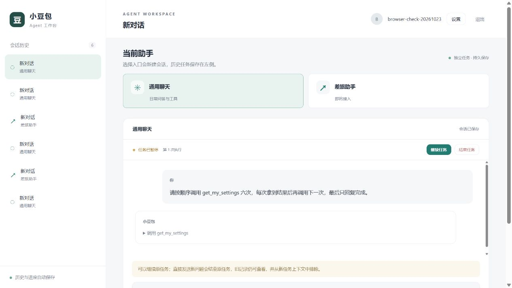

# 真实模型验收（2026-10-23）

使用用户在本地 .env 配置的 OpenAI 兼容服务，通过平台 Go API、真实 Eino 和 PostgreSQL 执行。没有输出模型密钥、接口地址、账户密码或断点 payload。仅修改验收脚本的触发时机，未修改产品行为。

## 实际结果

| 验收 | 证据与结果 |
| --- | --- |
| 真实聊天与工具 | model-smoke.ps1 通过，真实模型调用 get_my_settings 并生成回答；浏览器展示调用、设置结果和最终回答 |
| 安全边界暂停/恢复 | model-smoke.ps1 -ExerciseRecovery 通过；读取 paused 不自动执行；新页面显式恢复同一 Run，attempt=2，最终 succeeded |
| 页面内切换 | 真实任务运行时切换差旅入口，再从历史返回，仍为执行中；差旅仅展示未接入 |
| 离开运行页面 | 浏览器从任务页导航到 about:blank，触发真实 pagehide；服务端 /pages/:id/leave 返回 204，耗时 1268ms；重开显示 paused 和继续入口，没有自动执行 |
| 重开与手动继续 | 页面真实关闭/重开已暂停任务，保持 attempt=1；点击继续后原 Run 以 attempt=2 完成。另一次 pagehide 暂停的任务也恢复完成 |
| 新问题替代 | 暂停包含独有标记的任务，再发新问题，得到真实回答 NEW_TASK_OK；旧标记与旧历史仍在界面中，旧任务 cancelled、context_eligible=false、checkpoint.valid=false，历史仍有 3 行 |
| 强制停止降级 | 长回答途中暂停未取得有效断点，返回 interrupted，不提供继续。实际关闭短任务时，离开通知未必送达，任务可能在租约到期前自然完成；关闭较长任务的实测也出现 interrupted，未虚报 paused |

浏览器使用合成验收账户，不涉及用户真实业务数据。新问题的实际模型输入排除由 TestSupersededRunVisibleButExcluded 检查；不能仅凭 NEW_TASK_OK 回答推断模型看不到旧上下文。

## 可核对的数据库证据

只读查询已核对下列合成任务，没有读取或输出 checkpoint payload：

| Run | 终态 | attempt | context_eligible | checkpoint.valid | 历史行数 |
| --- | --- | --- | --- | --- | --- |
| 7bdc54ae-682e-4cfc-8ee9-4bf8e4e9bb27 | succeeded | 2 | true | false | 8 |
| 0892ef23-2f94-4ee5-aa65-4cc24dc88191 | cancelled | 1 | false | false | 3 |
| 2c807256-2580-4a52-bf6c-ff067d47da3c | succeeded | 1 | true | false | 2 |
| 580c88c3-6103-4c48-b071-7ed80c4c36fc | succeeded | 2 | true | false | 14 |

本地脱敏报告：.cache/reports/model-smoke.json。原始日志与配置被 Git 忽略。

## 验收脚本调整与限制

原脚本等三千字长回答开始后再暂停，实际触发强制流取消，失败原因是没有安全断点。修订为三次短工具步骤启动后请求暂停，实际恢复成功；前一次失败仍保留为上表的降级证据，没有把长流恢复宣称为通过。

暂停恢复限于 Eino 支持的安全执行边界，不能保证任意 Token 位置续写。此次没有启用 RAG、审批、本地执行、外部写工具或差旅 Agent。
