## Context

参见 proposal.md 与 specs/。2026-10-22 检查时项目仅有目录骨架。2026-10-23 用户选择单代理执行，并后续授权安装注册本机 PostgreSQL；现有 Go 1.27.2、Node 24.20.0、PostgreSQL 17.11、OpenSpec 1.12.0，代码保存在 feat/agent-platform-mvp 分支。任务 1–7 已落地，任务 8 的真实模型与浏览器验收已通过，当前等待 Linux race CI。Docker 未安装，部署文件提供为可选路径。

选定参考：[chatwitheino](https://github.com/cloudwego/eino-examples/tree/main/quickstart/chatwitheino)。读取的 go.mod 使用 Eino v0.9.0-beta.1、Go 1.24.9；agent.go 构建 DeepAgent，server/server.go 使用 TurnLoop，main.go 的 CheckpointStore 是内存实现，mem/store.go 使用 JSONL。这些不能作为平台持久化方案直接保留。

## Goals / Non-Goals

**Goals:** 保持 Service 与 Agent 并列、复用 Eino 执行与恢复机制、通过 PostgreSQL 实现可靠存储、让行为可测试并提供真实演示路径。

**Non-Goals:** 首版不实现差旅远程调用、长期记忆自动抽取、用户凭据中心、MCP、Redis、队列、多实例执行或自动恢复调度；未开启的功能不生成空实现冒充交付。

## Decisions

### D1. 模块边界与依赖

```mermaid
flowchart TB
  H[Handler] --> A[Application]
  H --> S[Service]
  A --> S
  A --> M[AgentManager]
  M --> G[GeneralAgent 平台适配]
  G --> E[Eino Agent / TurnLoop]
  E --> C[Model / Tools / Context]
  C --> T[业务 Tool 接口]
  T --> S
  C --> P[Store 接口]
  M --> P
  P --> R[Repository]
  S --> R
  C --> CL[Client]
  S --> CL
  R --> DB[(PostgreSQL)]
  CL --> API[模型 API]
  M -.预留.-> TR[TravelAdapter]
```



图表示运行时调用。接口定义在消费者侧；bootstrap 注入实现。Application 不访问具体 Repository；业务工具通过 Service 执行业务规则；Run、事件、消息、Checkpoint 通过 Store 访问 Repository。Repository 不决定业务权限，不反向调用上层。

Agent 主链为 Manager → 实现层 → 内核 → 能力 → 接口与访问实现 → 基础设施；Manager 的执行记录持久化是旁路，不必经过内核。差旅未来在远端重复其自身内核和能力流程，不先经过 GeneralAgent。

### D2. 目录与框架裁剪

保留当前 backend/internal 下 bootstrap、config、router、middleware、handler、application/chat、service/{auth,user,conversation,settings}、agent/{contracts,manager,agents/general,agents/travel,tools,memory,ports}、agenttools、repository/postgres、client/llm、model。

首版 general 下使用 agent.go、runner.go、checkpoint_store.go、repository_store.go；manager 下使用 manager.go、registry.go、lifecycle.go、lease_manager.go、events.go、metrics.go。Store 契约先合并在 ports/stores.go，具体接口按消费者定义。无业务需求前不新增独立 runtime 包；前端使用 React + Vite + TypeScript。

沿用 example 的 Agent 构建、TurnLoop、事件回调和 Checkpoint/Resume 架构；由于用户选择分阶段启用能力，首版采用 Eino ChatModelAgent + TurnLoop，不构造附带本地 Backend 的完整 DeepAgent，不开放文件与 shell。采用 example 中标准 schema.Message 路径，避免同时维护两种消息模型。不直接依赖 example 的 package main 或 ../.. replace；参考代码迁移时保留许可证说明。

框架依赖固定 Eino v0.9.0-beta.1，模型扩展先用示例对应的 openai v0.1.12；其他 Go/npm 直接依赖在首次安装后固定版本和锁文件。先以兼容性探针证明指定版本的暂停恢复，再铺开业务实现；若探针推翻方案，先更新本设计与计划，不假装断点机制已验证。

### D3. 基础平台与认证

Go + Gin；PostgreSQL 为唯一正式存储，pgx 负责连接池与显式 SQL；不引入 ORM。首版单实例，启动时持有独立连接上的 PostgreSQL advisory lock；第二个实例拒绝进入任务恢复与执行流程，防止把别的实例正在运行的任务误标中断。

认证默认服务端 Session：随机高熵令牌仅放 HttpOnly Cookie，数据库保存令牌摘要及过期时间，密码用 bcrypt；生产 Secure、SameSite=Lax，写请求检查同源与 CSRF token。本地 HTTP 仅开发配置允许 Secure=false。此为最小技术默认，不实现 JWT/Refresh Token 双体系。会话默认有效 7 天；用户标识按 trim/lowercase 规范化并唯一约束。

外部模型仅使用服务端可信配置的 Base URL、模型 ID 和 API Key；不开放用户任意 Base URL，不将 Key 放到前端、日志、断点或模型上下文。未配置模型时返回 model_unavailable。登录与模型调用有基础限流；首版进程内限流即可。

### D4. 数据所有权与最小模型

| 表 | 核心字段与约束 |
| --- | --- |
| users | id、规范化账户标识 UNIQUE、密码摘要、状态、时间 |
| sessions | id、user_id、token_hash UNIQUE、csrf_hash、expires_at、revoked_at |
| page_leases | id、user_id、session_id、page_token_hash、last_seen_at、expires_at、closed_at；绑定发起页面 |
| user_settings | user_id PK、theme、reply_preference |
| conversations | id、user_id、agent_type、title、deleted_at、时间 |
| messages | id、conversation_id、run_id、role、content、tool_call_id、ordinal、display_status；会话内 ordinal 唯一 |
| agent_runs | id、user_id、conversation_id、page_id、idempotency_key、request_hash、status、attempt、version、context_eligible、error_code、config_fingerprint、时间 |
| run_events | run_id、seq、attempt、type、脱敏 payload、时间；(run_id,seq) 唯一 |
| checkpoints | run_id PK、user_id、conversation_id、engine、engine_version、format_version、attempt、payload BYTEA、valid、时间 |

幂等键唯一范围为 (user_id, conversation_id, idempotency_key)；request_hash 覆盖消息和有效执行选项，不包含临时 page_id、page_token 或网络请求标识。跨页面重试同一请求返回原 Run，不改变执行归属；只有显式恢复才转移归属。会话在 accepted/running/pausing/paused/resuming/cancelling 状态下最多一个非终态 Run，以部分唯一索引约束。新问题替代 paused Run 必须先在同一事务结束旧 Run、context_eligible=false、使断点失效，再创建新 Run 和用户消息。

Repository 提供语义事务 AcceptRun、CompleteRun、SupersedePausedRun、FinalizePause；完成回答、成功状态与终态事件共同提交。Eino GenInput 不再重复保存已由 AcceptRun 保存的用户消息。中间消息记录 attempt，写入时校验当前执行围栏，并按 (run_id,source_key) 幂等保存；source_key 由消息角色与工具调用 ID 派生，恢复后的重复投递不会重复展示。最终消息在完成事务中追加。

页面令牌通过 X-Page-Token 请求头发送；提交与恢复验证页面、用户、登录会话与令牌，令牌不进入 URL。撤销 Session 后，工具读取设置也会拒绝访问。

Eino 类型不进入业务实体；messages 通过适配转换为 schema.Message。工具名称、调用 ID 与结果配对必须保留，不能只存最终文本。

### D5. Manager、执行器与状态迁移

Manager 是统一入口，registry 选择静态实现，RunManager 是 Run 迁移的唯一业务所有者。GeneralAgent 创建每个 Run 独立的 Execution，封装对应 TurnLoop 和停止句柄，不能共享可变用户上下文。

执行器只报告事件和结果；Manager 的事件接收器携带 user_id/run_id/attempt，所有消息与断点写入必须校验该执行尝试仍有效。数据库 version 条件更新与 attempt fencing 拒绝旧回调。内核因暂停或取消而退出时，不能走普通失败/成功的收尾分支，必须根据平台请求原因和框架实际退出结果完成对应迁移。

```text
accepted → running → succeeded / failed / timed_out
running → pausing → paused → resuming → running
非终态 → cancelling → cancelled
恢复不可行的旧执行 → interrupted
paused + 新问题 → cancelled(replaced_by_new_query) + 新 Run
```

结束任务与暂停不同：结束使断点失效；正常结束和被替代均不允许恢复。出现未知外部结果不宣称安全回滚。正式工具仅只读，工具重试与副作用策略仍在接口上明确。

默认每个会话一个非终态任务、每用户最多 3 个执行中的 Run、进程最多 8 个；paused 不占运行配额。默认单次活动执行 120 秒、最多 8 次模型迭代、单工具 10 秒；暂停期间不消耗执行时限，恢复后采用新的活动时限。配置值在配置模块校验并写入部署文档。

### D6. Eino Checkpoint 与平台任务管理

官方机制参考：
- https://www.cloudwego.io/docs/eino/core_modules/eino_adk/agent_cancel_and_turnloop_quickstart/
- https://github.com/cloudwego/eino-examples/blob/main/quickstart/chatwitheino/server/server.go

TurnLoop 配置 Store、CheckpointID 和 GenResume。CheckpointID 使用带命名空间的 Run ID，恢复同一 Run 使用同一标识；不直接用用户可控字符串读取断点。

general/checkpoint_store.go 实现 Eino CheckPointStore 的 Get/Set，以及可选 Delete，内部调用平台 CheckpointStore 再到 Repository。Eino payload 当作框架拥有的 opaque bytes 保存，不解析或自建模型执行快照；外围元数据记录用户范围、版本、attempt 与有效性。T 类型按 Eino gob 编解码要求注册稳定类型。

暂停调用该版本 TurnLoop 的安全停止并设置 15 秒上限；读取实际退出结果和 Checkpoint 写入结果。只有 loop 已退出、恢复所需 payload 可读且本次 attempt 匹配时，FinalizePause 才能提交 paused。超时降级停止后仍须检查真实结果；若无法证明断点可用则 interrupted，不沿用更早且可能重复操作的旧断点。

实施探针确认 Stop 是非阻塞提交：平台先等待 TurnContext.Stopped 确认取消已施加，再等待实际退出。流式取消事件仍须完整消费，不能在框架完成中断处理前退出回调。强制截流的探针曾观察到已完成工具重放，因此此类停止拒绝持久化 checkpoint，按 interrupted 处理；安全工具边界恢复已验证不重放完成工具。恢复输出模式由框架保存状态决定，不伪造 Token 级续传。

示例 GenResume 只接收 ApprovalResult，不能原样用于页面关闭恢复。平台适配为独立的 continue 指令：保留 TurnLoop 需要的已消费与待处理项，由 Eino 恢复 checkpoint；审批 Targets 只在未来审批功能中使用。不借助普通新用户消息伪装成恢复。

恢复先 CAS paused→resuming，检查用户、会话、版本、有效断点和模型配置指纹，再创建新的 Execution；恢复尝试递增 attempt，使用围栏保护存储。读取旧 checkpoint 只能由成功获得恢复权的尝试进行，保存新 checkpoint 时绑定新 attempt。恢复不创建第二条用户问题。

MVP 不实现跨不兼容框架版本迁移。版本或工具配置不兼容时报告 checkpoint_incompatible，保留历史但不启动内核。断点可能含敏感上下文，不能通过面向前端的 API 返回 payload。

### D7. 页面在线、SSE 与重启

每个新文档实例加载时生成新的随机 page_id，不因 sessionStorage 被复制到新标签页而复用旧页面身份；页面内路由切换保持它不变。后端颁发绑定当前登录 Session 的 page_token，并在 page_leases 保存摘要。请求中的 page_id 本身不能证明页面归属。每页独立 page_token，不在用户级维护一个“在线”开关。

页面每 5 秒发送心跳，20 秒未刷新租约则视为离线；pagehide 的 best-effort 通知可以加快检测，不能作为唯一依据。页面内切换会话不停止心跳；SSE 取消仅移除订阅，不触发暂停。其他页面不能更新发起页面的租约。恢复成功后 page_id 转移至点击继续的页面。

刷新/短暂断网采用相同租约判定：超时才触发暂停，重开不自动恢复。前端定期重新验证本人 Session；登出撤销 page_token，并对该登录会话发起的任务执行同样的暂停流程，不能继续使用已撤销身份运行工具。

启动完成并获得单实例锁后扫描旧非终态任务：有效兼容 checkpoint→paused；没有有效断点→interrupted。原处于 paused 的任务保持暂停；没有任何自动模型调用。进程意外崩溃不保证生成新断点，只能恢复已持久化的有效断点。

### D8. 上下文和展示历史分离

history 查询始终返回允许展示的历史；ContextBuilder 只选择当前用户、当前会话中 context_eligible=true 的已完成任务和当前 Run 消息，按模型预算裁剪，保留完整工具调用/结果组。

paused Run 被新问题替代时置 context_eligible=false；排除其用户消息、部分回答、工具调用、工具结果及其衍生摘要。首版不做长期记忆自动抽取，避免删除语义被异步任务破坏。更早正常完成的任务仍可参与上下文；不是清空整个会话。

从 Eino checkpoint 恢复属于另一条路径，不能再将展示历史全部追加进去。新任务不能读取旧 Run checkpoint，旧尝试也不能重新激活已失效断点。

### D9. API 与流式事件

基础前缀 /api/v1；JSON 错误结构 {code,message,request_id}，400 参数、401 未登录、404 无权资源、409 状态/幂等冲突、503 模型/Agent 不可用。

| 接口 | 行为 |
| --- | --- |
| POST /auth/register, /auth/login, /auth/logout | 身份入口；login 返回 CSRF token，Cookie 保存 Session |
| GET /me, GET/PATCH /settings | 当前用户及设置 |
| GET/POST /conversations | 分页列表与按入口创建 |
| PATCH/DELETE /conversations/:id | 重命名、受控删除 |
| GET /conversations/:id/messages | 稳定游标分页 |
| GET /agents | general 可用状态；travel 明确未接入 |
| POST /pages, POST /pages/:id/heartbeat, POST /pages/:id/leave | 获取页面租约、心跳、best-effort 离开 |
| POST /conversations/:id/runs | Idempotency-Key + content + page_id；入口取自会话 |
| GET /runs/:id | 状态、恢复能力、已有输出及错误 |
| GET /runs/:id/events | 经过认证的 SSE；不在 URL 放凭据 |
| POST /runs/:id/pause, /resume, /cancel | 显式生命周期操作，resume 携带新 page_id |

持久事件包含 run.accepted/started/pausing/paused/resumed/completed/failed/cancelled/interrupted 和工具状态；message.delta 是临时事件，不逐 Token 持久化。持久事件先写库后发布，seq 单调；SSE id 只用于持久事件。订阅时先连接有界订阅缓冲，再读取持久事件并按 seq 去重，处理查询与订阅之间的竞争。过慢客户端断开订阅，仍可 GET 权威状态。未完成文本合并后节流保存并在安全暂停/结束时刷新；不承诺 Token 级续传。

### D10. 工具、Client 与未来差旅

首个工具 get_my_settings 经 agenttools → SettingsReader 接口 → SettingsService → Repository，模型不传 user_id。模型能看到的工具先筛选，工具调用入口再次检查授权与 Schema，并限制结果大小。未知工具请求有明确错误，不启用本地 shell/file 工具。

模型 Client 负责配置与网络协议；GeneralAgent 决定如何使用模型，不让 Handler 调模型。测试注入可控模型/工具，但产品不提供静默模拟模式。

差旅当前只登记 unavailable。未来 TravelAdapter 经 Client 调用独立内核；Python 内核的数据通过受认证的 Go 内部存储 API 进入统一 Repository，不能直接 import Go 包，也不能暴露通用 SQL/任意表接口。内部 API、实际状态格式、行程业务规则与权限必须在差旅重构变更中单独定义；不要求 Python 理解 Eino gob payload。

### D11. 交付与验证

提供 Compose 启动 PostgreSQL 与应用的路径，同时支持本机 PostgreSQL；按用户后续授权已安装并注册本机数据库，本轮不安装 Docker。不使用 SQLite/内存作为正式替代。环境变量 DB_DSN、LLM_BASE_URL、LLM_MODEL、LLM_API_KEY、HTTP_ADDR、PUBLIC_ORIGIN、COOKIE_SECURE、运行预算有示例但不含真实秘密。页面租约返回 heartbeat_ms，前端使用服务器配置的心跳间隔，默认 5 秒。

单元测试注入模型与 Store，Eino 兼容性测试使用真实框架、可控模型和可控工具；PostgreSQL 集成测试使用真实数据库及独立 schema。测试报告分为单元、真实数据库、真实模型三类；无 TEST_DATABASE_URL 时集成测试显式 skip，最终报告必须标“未验证”，独立发布验收入口要求缺少数据库时失败。

Windows 本机不假装支持 race：基础检查 go test ./...、go vet ./...；Go race 需要支持的 C 工具链，若不具备则在 Linux CI 执行并记录结果。前端执行 npm ci、npm run test -- --run、npm run build。真实模型冒烟必须由实际响应和工具事件证明，不打印 Key。

## Risks / Trade-offs

- [Eino 当前选定版本为 beta] → 固定版本；兼容性探针优先；检查源代码对应 API，不套用不同版本文档。
- [页面关闭不能被浏览器可靠通知] → 页面租约 + best-effort 通知；产品明确有限检测延迟。
- [安全点等待超过预算或模型请求中途停止] → 明确 pausing/interrupted；只恢复框架可用断点，不宣称从 Token 位置无损续写。
- [跨表写入和 Eino checkpoint 回调不是天然同事务] → 断点保存成功后再 FinalizePause，启动时对账；不提前宣布 paused。
- [任务恢复前外部副作用结果未知] → 首版只读工具；后续写工具必须引入业务幂等和核对机制。
- [单实例限制扩展性] → 明确支持范围，保留数据库围栏；多实例调度另做变更。
- [本机缺 PostgreSQL/Docker] → 不阻塞文档和纯单元验证；真实集成与发布验收保持未完成。
- [尚无 Git 仓库] → 不伪造分支、提交和 PR；实施前单独初始化本地 Git，再按所选执行方式管理变更。

## Migration Plan

先完成 Eino 兼容性验证与规格审阅，随后按 tasks.md 和详细计划进行 TDD。数据库采用版本化迁移；本地开发可重建测试 schema，生产回滚不能自动删除用户数据。配置错误或数据库不可达时启动失败，模型未配置时平台基础功能可用但聊天明确不可用。

完成测试审核与规格核对后才同步/归档 OpenSpec。当前 CLI 的 verify 能力需核实；没有专用 verify 工作流时人工逐条核对需求、场景、任务和证据，不能把 openspec validate 说成实现验证。

## Open Questions

无阻塞性的产品问题。执行方式由用户在文档审阅时选择；真实数据库安装方案与真实模型凭据在集成验证前提供，不能据此缩减既定 MVP 行为。

