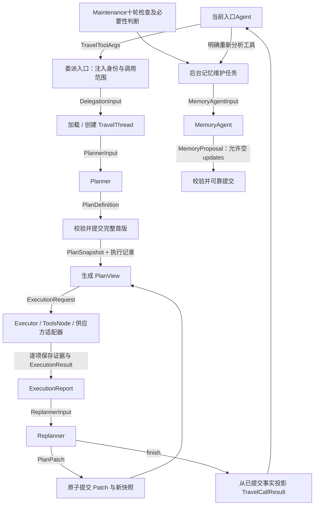

# 组件数据契约：规划v1与共享查询边界

更新：2026-11-06。本附录及JSON Schema描述规划/Patch/证据领域DTO及新增运行v1类型；行为见[specs](../specs/)，技术依据见[Design](../design.md)。任务MCP/可信_meta/输入hash见[执行附录4.1](../mq-mcp-dispatch-protocol.md#41-运行契约v1)，跨服务归属见[数据库第0节](../database/README.md)。夹具校验不代表协议、权限或事务已实现。

周期记忆检查属于Maintenance；GeneralContext.memory_review仅兼容已有材料，不要求入口执行周期判断。continue表示后续问题继续已有计划/Thread，不是用户手动恢复。

## 0. 最新入口与共享查询边界

2026-11-03 用户明确保留General和差旅助手两个入口。两个入口共享无TripPlan查询；规划/正式计划修改进入同一专业子流程。下列原v1的TravelToolArgs、ExecutionRequest/Result、Replanner等类型仅描述专业规划，不是所有查询的统一外壳。GeneralContext名称暂作为入口上下文结构沿用，差旅入口同样按该结构装配；入口类型由可信会话/Thread提供，不由模型注入。

| 路径 | 输入及可信元数据 | 保存与输出 |
| --- | --- | --- |
| 入口直接查询 | 工具原有参数Schema；程序注入user/conversation/run/thread、调用身份和期限，不要求plan/task | SharedToolCallRecord + SharedToolEvidenceRecord；返回工具原有结果和稳定证据引用 |
| 进入专业规划 | 当前入口形成TravelToolArgs，程序注入RuntimeScope | 创建/加载plan_work线程及delegation；返回TravelCallResult |
| 计划Executor查询 | 正式Task展开ExecutionRequest，再适配共享查询服务 | 共享调用和证据保存后，执行项复核Task/generation并投影ExecutionResult |

SharedToolCallRecord/SharedToolEvidenceRecord是设计材料中的内部记录投影，不是要求所有MCP工具改用同一个参数/输出协议。现有设置、网页、RAG等已发布工具契约保持各自协议，具体供应方参数仍由其注册Schema校验。

根Thread可为general/travel，thread_role=entry；计划TravelThread为travel/plan_work。差旅入口直接查询不创建子线程。两入口规划通过同一入口链进入专业流程，不需要Travel先调用General。工具调用成功和计划接受结果分别保存，外部事实无plan_id前置要求。

## 1. 专业规划的数据流



一个用户请求一个Run，入口和完整Travel委派各有Job，TravelThread持续存在。RAG是当前Job内的同步MCP工具，只有tool_calls身份，无独立Job/消息交接；调用期间当前Job保持running、续租并占槽。恢复先核对Run及Job资格，优先复用保存的证据/模型响应；专业结果再异步交回入口，不靠聊天历史猜恢复位置。

## 2. 文件和阅读顺序

本次讨论的完整 Markdown 阅读版见 [领域与数据](../../../../docs/architecture-final/02-domain-data-and-rag.md)，包含短期/长期记忆及最新数据库职责。Eino 编排沿用已确认方案，本附录维护具体字段和传输规则。

| 文件 | 内容 |
| --- | --- |
| [agent-contracts.schema.json](agent-contracts.schema.json) | Draft 2020-12；通过 `$defs` 提供各个边界类型，不要求给所有工具套相同外壳 |
| [examples/manifest.json](examples/manifest.json) | 所有示例与对应类型；场景均为虚构夹具 |
| [validate_contracts.py](validate_contracts.py) | 设计材料的结构、局部引用和关键反例校验，不是产品校验器 |
| [verification.md](verification.md) | 实际校验结果与尚未验证的边界 |

Schema 是边界结构定义，不能单独证明权限、版本、来源真实性、模型语义正确或提交成功。文中明确列出的程序规则同样属于契约；实现时由领域服务检查。Schema 不引用外部在线定义。

## 3. 组件边界和字段归属

| 边界 | 类型 / 关键字段 | 谁产生，接收方做什么 |
| --- | --- | --- |
| 上下文装配 → 当前入口 | `GeneralContext`：request、short_term、long_term_memories、related_plans | 程序提供有效记忆和目录，周期检查由Maintenance执行；旧memory_review字段不授权新入口自动检查 |
| 当前入口 → 差旅工具 | `TravelToolArgs`：mode、request、context；continue 时含 target | 当前入口选择新建/继续及必要摘要；入口校验目标归属和绑定 |
| 工具入口 → 子上下文加载 | `DelegationInput`：schema_version、scope、args | 程序注入 user/thread/run/tool_call/operation/attempt/deadline，模型无权指定身份 |
| 准备阶段 → Planner | `PlannerInput`：request、delegation_context、working_memory、policy_status、facts | 加载真实上下文与政策状态；不是把原始工具日志全量复制进去 |
| Planner → 计划提交 | `PlanDefinition`：title、goal、purpose、timezone、stops、legs、requirements、tasks | 模型只给定义，不给已执行状态、版本或虚构候选 |
| 计划服务 → 持久化 | `PlanSnapshot`：plan_id、travel_thread_id、revision、definition、task_versions、selections | 程序分配身份和版本，业务提交与 actions 成功结果同事务 |
| 业务事实 → Executor | `PlanView`：snapshot、items | 根据已提交定义和执行记录投影，不单独维护第二份状态 |
| Executor → 查询适配器 | `ExecutionRequest`：Task/Item/执行代次、实际 input、requirements、ranking、input_hash | 程序从 Task 展开参数，必需输入未就绪就不发查询 |
| 查询 → Executor / Replanner | `ExecutionResult` → `ExecutionReport` | 逐项保存执行结果和证据，再汇总；不能等整批结束才落库 |
| 汇总 → Replanner | `ReplannerInput`：request、plan、execution、prior_replans | 给当前正式计划、结果、此前重规划原因/修改/效果，不要求 HTTP 调用全过程 |
| Replanner → 业务提交 / 收尾 | `ReplannerDecision`：patch 或 finish | Patch 经过校验提交；finish 不能伪造已提交计划或执行结果 |
| 差旅 → 当前入口 | `TravelCallResult` | 调用是否成功与目标完成程度分开，真实事实有引用，未解决问题明确保留 |
| 明确重新分析工具/ Maintenance → 后台维护 | `MemorySubmitArgs`领域部分 → `MemoryTaskReceipt` | 工具保留真实调用身份，Maintenance使用周期decision_key；固定范围，accepted/saved=false只证明受理 |
| 当前入口 → 明确记忆操作 | `MemoryWriteArgs` → `MemoryWriteResult` | 已有明确用户指令才直接提交 add/replace/retract；同步返回真实写入结果，不经过 MemoryAgent |
| 后台 → MemoryAgent → 提交 | `MemoryAgentInput` → `MemoryProposal` → `MemoryMaintenanceResult` | 统一用户记忆、带来源；可无更新，提交检查修订与权威级别 |

TravelToolArgs是模型填写参数，scope由可信运行层注入。恢复复用tool_call_id/operation_id，新业务调用才新身份。旧RuntimeScope.attempt不代表多个Job执行权：所属服务的本地任务上下文校验job/task及lease_epoch，平台调度校验dispatch_seq/断点；线上TrustedTravelMeta传scope及固定来源，不把父epoch传给Travel当执行权。deadline不晚于祖先，字段不自动授权跨主Thread读取。

`context.text` 是当前入口Agent选择的有效历史摘要，`sources` 指向其依据，`through_message_id` 标记截至位置。首次包含必要历史，继续时只含上次委派之后的相关主线程增量；当前新要求单独放 request。TravelThread 自身的旧工作记忆由程序加载，不让当前入口Agent重传、覆盖整段子历史。引用存在不能证明摘要忠实，仍需模型判断及后续评估。

GeneralContext（两个入口共用的结构）是提示词准备阶段的业务上下文，不是替代框架消息协议的整套输入；当前 Run 的用户原文与工具调用/返回仍保留在现有 Messages 中。摘要和 recent_turns 只覆盖历史完整 Run，同一已覆盖历史不重复注入；request 是当前用户消息的引用和原文投影，组装时只生成一次该用户消息。执行位置由 checkpoint 管理，模型按需看到目录中的真实 progress 和当前工具结果，不把完整恢复状态 JSON 注入提示词。

## 4. 计划定义、运行状态和结果分开

| 内容 | 放在哪里 | 关键规则 |
| --- | --- | --- |
| 城市、入住/退房、人数、关键词 | `TaskDefinition.parameters.hotel/train/web/weather` | Task 是查询参数的唯一正式定义位置；Stop/Leg 表示路线关系，不在 Item 复制参数 |
| 要求与来源 | `requirements` + Task.requirement_ids | 政策＞用户＞记忆；计划级要求作用于所有 Task，任务级引用双向一致；模型整体取舍、排序及解释 |
| 查询动作 | Task.items：item_id、domain、depends_on | Item 只声明查询，不含 select、价格、参数或 needs_query |
| 查询依据版本 | `task_versions` | 与 Task 一一对应，由程序维护；包含关联 Stop/Leg、适用要求等有效定义的变化 |
| 是否待查询 | `PlanView.items[].needs_query` | 从当前 Task 版本和执行记录投影；不是模型写的免查标签 |
| 实际调用和结果 | ExecutionRequest / ExecutionResult | 固化当时输入与代次；来源证据单独保存 |
| 已选候选 | snapshot.selections | 只保存真实证据引用、对应 Task 版本及理由，不是查询 Item |

任何 Task 有效定义变化，该 Task 的 **所有查询 Item 都重查**，包括看似参数未变的 Item。Task 自身描述、parameters、ranking、items、作用到它的要求及关联路线定义均纳入有效定义比较。其他有效定义未变的 Task 不因全局 plan revision 增长而重查。执行状态、查询结果和 selection 不是 Task 定义，不造成循环重查。

选择单独提交可以增加 plan revision，task_revision 保持不变。Task 定义变更后，旧选择仍可作为历史记录，但不得作为当前有效选择；本版最终快照中的 selections 必须移除受影响旧选择，或在取得新版本证据后重新选择。查询结果更新不会暗中把旧证据引用改指向新结果。

日期/人数未知可在正式最小计划中为空或缺省；执行请求中按领域要求变为必填。酒店至少 city/check_in/check_out/guests，列车至少 origin/destination/departure_date/passengers，天气至少 city/date，网页至少 query。这是内部标准化输入，不是对供应商接口能力的承诺；供应方不支持的字段或能力要明确报告。人数不自动假设为 1，示例中的 1 是假设用户已提供的输入。

Stop 日期表示计划要求，不是查到的列车时刻；Task 酒店日期可以只覆盖一部分停留，不强制等于 Stop 区间。来源冲突、价格超出期望等交给模型按优先级规划和解释，不建立 hard/soft 或候选资格过滤器。程序仍检查日期表示、数量范围、权限、真实引用和提交一致性。

`depends_on` 只用于真实数据依赖：例如查询必须使用上一步才得到的地点。独立的酒店/车次查询可以并行，不因路线先后增加执行依赖。字段未就绪时不猜测；Replanner 可把已获得事实写入 Task 后安排后续查询。依赖引用必须存在且无环；本版不定义任意模板语言或执行脚本。

## 5. Patch 全集与应用语义

传输为 JSON；`travel_plan_revisions.patch` 和完整 `snapshot` 为 JSONB。首版提交完整定义，后续以稳定 ID 修改。`PlanPatch` 的 plan_id、expected_revision、reason、operations 必填；运行时 operation_id 位于可信提交范围，不由 Patch 随意改写。

| 操作 | 载荷 |
| --- | --- |
| add_stop / add_leg / add_task / add_requirement | value 为完整新增对象；ID 必须不存在 |
| update_stop / update_leg / update_task / update_requirement | 对应稳定 ID + changes |
| remove_stop / remove_leg / remove_task / remove_requirement | 对应稳定 ID；不能留下悬空引用 |
| update_plan | changes；只修改 title、goal、purpose、timezone |
| reorder_stops / reorder_tasks | 完整 stop_ids / task_ids 排列，不增删对象 |
| set_selection / clear_selection | 完整 selection 或 selection_id；selection 指向当前 Task 版本的真实候选 |
| refresh_queries | task_id、非空 item_ids、reason；显式重新查询，保留 Task 定义版本并增加执行 generation |

changes = `{ "set": { "parameters.hotel.check_in": "2026-11-11" }, "unset": [] }`。只接受命名字段路径，不接受数组下标或任意 JSON Pointer。未出现字段保持不变；set 的对象或数组整体替换该路径值，不做隐含递归合并；unset 明确删除；null 与缺省分开，仅可用于 Schema 允许为空的字段。set/unset 不能重复、重叠或祖先子孙冲突，changes 至少一项实际操作。

可写路径：update_stop 为 city/arrival_date/departure_date；update_leg 为 from_stop_id/to_stop_id/departure_date；update_task 为 title/target/parameters 及 parameters 的已定义子字段、requirement_ids/ranking/items；update_requirement 为 text/origin/scope/task_ids/sources。对象的稳定 ID、版本、needs_query、执行状态均不可写。改变来源仍必须有真实匹配的引用，不能把 memory 改标 policy 来提高权重。

同一 Patch 的操作按顺序在私有副本上应用，最终统一校验整张引用图。删除引用对象时，模型须在同一 Patch 更新/删除引用方；不做静默级联。定义变化影响到已有选择时同样清除或重新选择。任一操作失败整次不提交。expected_revision 冲突返回当前正式版本信息，模型基于新版本重提；不静默覆盖。

相同有效定义的无变化 Patch 不生成内容修订，也不触发定义重查。显式 refresh 属于实际业务操作：记录 action，更新 generation/执行记录；若无内容变化不强行生成新计划修订。旧执行代次的迟到结果可保留审计，但不能满足当前查询或覆盖新结果。

同 operation_id 同参数重复提交返回原 CommitResult；同 ID 不同参数拒绝。查询重试/恢复复用 execution_step_id/generation，新的刷新使用新代次。Task 定义变更增加 task_revision；plan_revision 用于整份计划并发提交，两者不可混用。input_hash 只是程序生成的审计信息，不能让哈希相同绕过“Task 变更后全查”。

## 6. 工具返回给模型的语义

`ExecutionResult.status` 表示执行结果，`coverage` 表示数据覆盖；`TravelCallResult.call_status` 表示差旅调用是否完成，`task_outcome` 表示用户目标 complete/partial/blocked。例如查询成功但无报价，可以 succeeded + partial；成功无候选是 succeeded + empty；超时重试耗尽是 failed + unavailable。不可把这些情况统一改成空数组成功。

报价未知为 null，不能写 0。真实的零价必须有证据，`Money.amount_minor` 使用最小货币单位整数，currency 为大写币种码，basis 区分每晚/全程/每人等。candidate.attributes 是供应方可扩展的事实字段，缺失在 missing_fields 中声明；不得塞入执行控制字段。网络 timeout 不能推导“没有酒店”。

| 情况 | 程序处理 | 模型得到什么 |
| --- | --- | --- |
| 结构/必需输入/引用错误 | 不调用或不提交 | validation、字段路径、可修正原因 |
| 无结果 / 部分未知 | 保存真实成功结果 | empty / partial 与具体缺失 |
| 临时网络、限流 | 既有可配置有限重试/熔断 | 耗尽后 transient 与 retry_exhausted；不能无限交回模型重试 |
| 供应方能力缺失 | 明确 unavailable/unsupported | 可换路径或解释的原因 |
| 版本冲突 | 不覆盖新版本 | conflict、当前计划版本由入口重新加载 |
| 系统期限 / 执行权或权限失效 | 传播内部停止，不继续无效模型循环；不暴露用户取消工具 | 已落库部分结果由外层终止/收尾路径处理 |
| 旧代次迟到结果 | 保存审计但不采用 | stale 不作为当前结果 |

本版 ErrorDetail 的 category/code/message/path/retry_exhausted/model_action 为模型可见错误体；日志、供应方原始响应和内部堆栈留在运行记录。真实权限错误不得通过模型重试绕过。

当前入口默认只收到当前主 Thread 相关的 `PlanDirectoryEntry`、必要计划摘要和本次 `TravelCallResult`。目录是投影，不另建目录事实表。成功返回的计划引用、commits 和 selections 都从已提交结果构造；最终自然语言不证明写入成功。已有 General 的设置、网页工具保持各自已发布参数/结果协议，不为了统一外壳强行破坏它们。

## 7. 短期与长期记忆

短期工作记忆：主 Thread 沿用 20,000 估算 token、80% 触发、每次最多合并 3 个旧完整轮次；摘要覆盖与近期原文不重复。可在 Run 内准备上下文时检查，但只压缩更早的完整 Run，当前 Run 的输入与工具调用配对保留。TravelThread 加载自身摘要/近期相关历史并接收主线程增量；Replanner使用更窄的prior_replans（理由、改动、效果），由actions、revisions、执行报告及必要事件投影；不从旧travel_decisions读取。子线程具体预算由后续存储/技术复核确定，不能误称与主线程已有相同实现。

长期记忆按user统一管理、区分domain。每个入口主Thread独立累计10轮有效用户对话；内部模型/工具/Item不计轮数。Maintenance程序检查后协调必要性模型，必要才总结；明确记住/修改/撤回由入口模型调用确定性工具，不等阈值、不做关键词识别。

| 游标/状态 | 何时更新 |
| --- | --- |
| reviewed_through_round | Maintenance必要性检查成功；判断不需要也推进 |
| summarized_through_round | MemoryAgent 总结并成功提交，包括 updates=[]；失败不推进失败覆盖 |
| memory_revision | 真正有记忆内容更新才增加；空更新不制造修订 |
| accepted | 持久化维护任务已受理；不能显示为已保存记忆 |

后台总结范围为上次成功总结之后到本次固化上界，不遗漏曾检查未总结的有效轮次；必要性判断另有review范围和已保存输出。源范围/游标由程序核对；派生摘要不是独立用户意愿，新增偏好仍追溯原始表达。原memory DTO样例是领域材料，Maintenance阶段/租约见数据库字典。

MemoryAgent只提出add/replace/retract，允许updates=[]；不指定自己是explicit或捏造来源。普通明确写入不额外总结，explicit_reanalysis才后台分析；Maintenance周期操作不伪造模型tool_call_id。inferred不覆盖explicit，不复活撤回项；修订CAS冲突后重新加载，必要才重算，稳定成功回执先复用。来源ID存在不能代替语义真实性。

后台维护使用memory_operation独立身份、租约和预算，不借已结束前台Run attempt。Maintenance自有循环认领周期检查/总结，不另建用户Run或Kafka Topic；幂等、游标、来源撤回和显式写竞争仍须实际验证。

## 8. Eino 组装和服务边界

以下为节点契约，非已经实现的框架代码。当前项目依赖 Eino `v0.9.0-beta.1`，已核对本地模块的 Chain、Lambda、ToolsNode、AgentTool 接口。

```text
TravelPlanningEntryChain:
  TravelToolArgs → DecodeAndValidate → BindTrustedScope → ResolveTargetAndLoadThread
  → AssemblePlannerOrResumeInput → TravelAgent → BuildCommittedTravelCallResult

PlanCommitChain:
  PlanDefinition | PlanPatch → ValidateStructure → LoadAuthorizedBase
  → ApplyToPrivateSnapshot → ValidateReferencesAndSources → ComputeTaskVersions
  → CommitSnapshotAndActionResult [领域服务事务] → PlanSnapshot + CommitResult

ExecutionChain:
  PlanView → PrepareReadyRequests → BuildToolCallMessages → ToolsNode
  → CollectPersistedItemResults → BuildExecutionReport

MemoryMaintenanceChain:
  MaintenanceThresholdCheck → DurableOperation → NecessityModelAndPersistOutcome
  → [if needed] LoadEffectiveHistoryAndMemory → MemoryAgent
  → ValidateProposalAndAuthority → CommitUpdatesAndCoverage [领域服务事务]
```

Eino 用法模式：`compose.NewChain[I,O]()` → `AppendLambda(compose.InvokableLambda(fn), compose.WithNodeName(...))` → `Compile(ctx)` → `Invoke(ctx, input)`。Lambda 接受/返回这里的 DTO 并调用服务；类型连得上不代表业务校验完成。

ToolsNode 接收含 ToolCalls 的 `*schema.Message`，输出 `[]*schema.Message`，不是直接接收 ExecutionRequest。需有两个确定性适配节点，并通过局部状态关联 scope、Task/Item、执行身份；不能从模型正文重建可信身份。每个共享查询工具内部先持久化调用及证据；计划侧再核验并接受单项结果，Collect 只汇总，恢复时才能找回已完成子项。

AgentTool 自定义输入 Schema 只是模型看到的参数描述，仍要解析和校验。当前默认输出抽取最后文本消息，专业规划工具需把最终业务DTO 确定性序列化到最终消息；不能假定 CustomizedOutput 会自动成为工具结果。共享 SessionValues 须隔离调用/计划；AgentAsTool 的嵌套执行状态不自动提供跨 Run 的 TravelThread 持久化。

明确重新分析工具可受理并返回receipt，周期任务由Maintenance创建；后台再运行对应模型/Chain。直接调用NewAgentTool会等待，不等于后台非阻塞。数据库事务/CAS/执行代次/幂等与真实来源校验由服务/仓储负责。

## 9. 示例分支

- 01～08：用户明确建立住宿安排后的规划分支，从规划参数到已保存的部分结果；不是纯酒店查询。
- **分支 A**：12、13 在 revision=1 收尾并返回部分结果。
- **分支 B**：09～11 在相同 v1 基础上增加网页查询，生成 v2；Task 改变，所以酒店也重查。这里只演示重规划后的状态，不伪造第二轮执行已完成。
- 14：在分支 A 的 v1 上继续调用的新要求；入口还要加载原 TravelThread，不是完整内层输入。
- 15～17：缺参最小计划、成功无候选、重试耗尽，三个独立情况。
- 18～25：无需记忆、受理、总结/空更新和各自提交结果；22/24 与 23/25 为互斥分支。
- 26 与 docs 中多城 fixture 内容一致；计划无查询结果，所有人数/日期均为示例已知要求。
- 27/28：在 v1 证据上单独选择候选，plan revision 增加而 task_revision 不变；与 09 分支互斥。
- 29：显式刷新，不改 Task 定义。示例 hash 与身份均为演示值，不可用于实际幂等或签名。
- 30：首次规划请求的入口业务上下文；31/32：明确记忆指令的直接写入分支；33：两表存储方案的用户 JSONB 记忆快照，条目仍使用 MemoryRecord。

- 34～36：General直接天气查询及真实证据、Travel入口直接查询的受理记录，均无plan/task/delegation前置身份。
- 37～43：Dispatch命令、提交/可信meta、受理、成功/失败结果及Task查找参数。全部是设计夹具，身份仍须认证＋control scope核验；失败可保留部分结果，受理不能当最终结果。其输入hash只适用于本份夹具，不作为运行授权。

## 10. 持久化与恢复的职责映射

| 存储职责 | 目标位置 | 从契约取什么 |
| --- | --- | --- |
| 主 Agent 会话上下文 | 平台 messages | 用户/助手消息、调用配对及归属；thread_id 关联 agent_threads，当前短期摘要及覆盖也在该 Thread |
| 外层运行事件 | 平台 run_events | 外层 Run 的执行进展和结束情况，不作为 TripPlan 事实表 |
| Job断点与父子依赖 | 平台checkpoints/agent_jobs | 各Job现场与原调用映射；先核对Run资格，再逐层真实返回，不覆盖新业务提交 |
| 消息/调用预算 | outbox_messages/outbound_calls/resource_limits | 可靠调度与物理尝试计账，不代替查询事实或操作回执 |
| 计划身份和当前版本 | travel_plans | plan_id、TravelThread 绑定、归属、当前版本和目录投影依据 |
| 不可变计划修订 | travel_plan_revisions | PlanSnapshot、PlanPatch、基准版本和修改依据 |
| 查询调度与实际执行 | travel_execution_steps | ExecutionRequest、代次、租约和结果状态；继任旧 query_jobs 的方式待迁移设计 |
| 共享工具调用 | tool_calls | SharedToolCallRecord；实际参数、身份、供应方、状态、重试、结果引用 |
| 供应方/RAG事实 | tool_evidence | SharedToolEvidenceRecord；不可变事实、候选、来源、缺失及时效；无计划前置 |
| 操作必要依据与规划历史 | travel_actions + travel_plan_revisions + 必要run_events | 受理操作参数及依据、实际Patch/结果、拒绝/校验错误；不再依赖独立决策表 |
| 可靠业务提交及回执 | travel_actions | operation_id、参数摘要、CommitResult，与计划修订同事务成功 |
| 长期记忆 / 覆盖 / 后台任务 | user_memory_revisions / memory_operations；根 agent_threads 中的两个游标 | 用户记忆修订、两个游标、维护任务身份及结果 |

平台保留五层分工，增加Job/Outbox及调用预算记录，不按Agent复制或以19限制表数。持续Thread、消息、摘要及后台任务见[数据库附录](../database/README.md)，运行字段和事务见[工程协议](../engineering-protocol.md)，兼容见[迁移矩阵](../database/migration.md)。恢复先读成功action/查询结果，不重复建线程或修订；DDL及实际接缝仍待验证。

## 11. 完成边界

本附录交付领域/运行字段、Schema、Patch、错误语义和可校验样例。Eino嵌套恢复/命名空间、HTTP_meta接法已完成隔离实验，搜索变更关系已核对，见[复核记录](../engineering-review.md)。尚需详细实施计划/执行方式选择、实际DDL/权限/迁移及跨进程验收。通用JCS、授权和事务不能由材料脚本证明，不能把它称为产品测试或实现verify。
