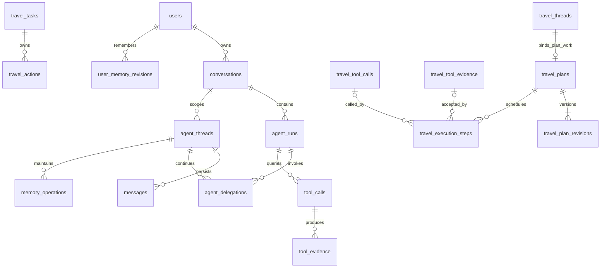

# 数据库领域字典与物理映射输入

更新：2026-11-06。本附录保留领域字段及约束供技术复核，正式行为见[specs](../specs/)，当前服务边界见[Design](../design.md)和[执行协议](../mq-mcp-dispatch-protocol.md)。

平台与Travel共PG实例、不同schema和角色，各自拥有任务/业务/证据，不跨服务业务FK或联合事务。下列原字段、数量及父子映射不能直接作为DDL，须按该边界重新核验。平台持有Delegation/Outbox/Dispatch，Travel持有Task及专业业务；公共预算和授权访问需单独限定权限。未生成或执行迁移SQL。

## 0. 技术复核后的服务归属

2026-11-06复核确认：下文L1～L5是逻辑职责字典，23不是目标物理表数。相同逻辑结构在平台/Travel分别保存自己的记录，不共享一套可相互写入的运行表。**所有FK只在所属服务schema内成立**；user_id/conversation_id/source_run_id等跨服务标识仅作已核验外部引用，不能生成跨schema业务FK。

| schema | 物理职责及约束 |
| --- | --- |
| platform | users/sessions/settings/page_leases、入口conversations/threads/messages、Run/入口Job/checkpoints/events、Delegation/Dispatch/Outbox、入口tool_calls/evidence、用户统一记忆及memory_operations；root Thread与主会话绑定；现有public表保留legacy读取，不默认搬表 |
| travel | tasks（持久专业任务，区别于计划JSON中的Task定义）、threads/messages/checkpoints、专业tool_calls/evidence、plans/revisions/execution_steps/actions；一个plan唯一绑定本schema的plan_work Thread |
| control | 私有session/run/context guards、execution_scopes、resource_limits/outbound_calls；仅白名单函数EXECUTE，不给运行角色直接表DML。详见[公共协议2.1](../engineering-protocol.md#21-公共授权与调用账的受控边界)，不另在platform/travel维护一份预算账 |

平台Delegation只保存remote_task_id/remote_thread_id及不可变输入/结果引用；`UNIQUE(run_id,tool_call_id)`保护原调用，不能以remote_task_id FK连接Travel。Travel受理唯一键为(caller_id,subject_id,request_key)，本地tasks关联threads/checkpoints/plans；跨服务来源引用携带origin_service/id/version/hash并经受控接口核验。平台消息序号只为平台会话分配，Travel工作消息使用自己的Thread内序号；不让远端服务争锁平台conversation分配ordinal。

迁移账号分别拥有本服务schema的DDL权限；运行账号仅有必要表DML和sequence权限，无对方schema业务权限、CREATE或BYPASSRLS。固定search_path并显式限定SQL schema；不能只设置search_path就声称完成权限隔离。单实例锁须在持久认领/围栏和独立串行迁移完成后移除。

## 1. 分层与取舍

数据库按职责分层，不为General/Travel复制运行表；三类Go进程加独立RAG、多Worker/多API方向保留。RAG同步MCP工具不建平台Job或自有异步请求/结果Outbox，其知识/索引/构建库独立。

| 层次 | 数量 | 表 | 负责什么 |
| --- | --- | --- | --- |
| L1 身份与连接 | 4 | users、sessions、user_settings、page_leases | 用户身份、登录、配置、前台页面租约 |
| L2 会话与 Agent 运行 | 11 | conversations、agent_runs、agent_jobs、messages、run_events、checkpoints、agent_threads、agent_delegations、outbox_messages、outbound_calls、resource_limits | 单Run/多Job、上下文、委派、可靠消息、预算/许可及恢复 |
| L3 共享工具与证据 | 2 | tool_calls、tool_evidence | 无须 TripPlan 的真实查询调用和不可变结果证据 |
| L4 差旅计划业务 | 4 | travel_plans、travel_plan_revisions、travel_execution_steps、travel_actions | 正式计划、版本、任务执行和可靠提交 |
| L5 用户长期记忆 | 2 | user_memory_revisions、memory_operations | 用户统一记忆快照和检查、写入、后台维护 |
| 合计 | 23 | 当前设计盘点，非数量限制 | 历史表保留及过渡断点表可能使物理数量更多 |

与上一版相比增加4张运行表，checkpoint演进不按表数限制物理迁移做法。tool_calls/tool_evidence继续承接共享查询；旧决策及证据表保留历史，不物理删除、不双写。

| 方向 | 取舍 | 本版处理 |
| --- | --- | --- |
| General 与 Travel 各一套会话、消息、工具记录 | 重复身份、运行控制及事实 | 不采用 |
| 所有查询仍创建最小 TripPlan | 与用户最新决定相反 | 不采用 |
| 只靠 messages 保存所有结构化证据 | 原始调用可以追溯，但稳定候选引用、时效查询和恢复容易依赖解析文本 | 消息保留交互；新增共享查询调用和证据层 |
| 查询事实共用，计划仍独立记录任务适用性 | 增加调用与执行项的明确关联，避免以工具成功冒充计划完成 | 推荐的工程方案 |

## 2. 对象关系与统一约定

- 一个用户请求只有一个 agent_runs；两种入口及内部专业委派都遵守这一规则。
- conversations.agent_type 为 general 或 travel，表示所选入口。各会话有根 agent_threads；两个入口不自动合并会话和上下文。
- 平台根线程是入口上下文，agent_kind 可为 general/travel；每份 TripPlan 在Travel服务另有独占plan_work线程。thread_role区分语义，但不让两个服务共享同一张线程表。
- agent_delegations 记录入口进入专业规划的一次逻辑调用。General 委派、差旅入口调用其内部规划模块均复用该记录；后者不额外调用 General，也不增加模型角色。
- 工具调用只要求 user/conversation/run/thread 归属，不要求 plan/task。计划执行项引用工具调用和证据，计划选择只引用证据版本和候选 ID。
- 同一用户的不同入口会话不因此获得自动跨会话访问；目录、证据和来源仍按既有授权范围装配。用户长期记忆按领域和有效性共享。
- 身份由程序生成，时间用 timestamptz，版本用 bigint，业务结构用版本化 JSONB。同服务的用户、会话、Run、Thread引用使用复合归属约束；跨服务按第0节处理；JSONB图关系、候选存在性和语义由服务校验。
- 不级联删除审计历史；不可变内容不原地改写。expires_at 未知用 NULL，不能解释成永久有效；报价未知用 NULL，不能写0。

## 3. L1：身份与连接（4表）

### 3.1 users

保存用户身份及创建时间，沿用001迁移已有字段和主键。作为所有数据的用户归属根；用户记忆提交复用 users 行锁序列化，不另建记忆头表。

### 3.2 sessions

保存登录会话、用户归属、失效及撤销信息。它是认证会话，不是聊天 conversations，也不是 AgentThread。前台登录状态不充当后台任务的工作租约。

### 3.3 user_settings

保存用户模型、界面等配置，沿用既有字段。设置不同于模型从对话归纳的长期记忆；密钥沿用现有保护方式，工具记录不复制认证头。

### 3.4 page_leases

保留浏览器页面接入/存在性记录及旧历史，不再通过其在线状态控制Run暂停或恢复。它不表示数据库业务锁，不承担Job或后台MemoryAgent的续租/授权。

以上四表字段以 backend/migrations/001_platform.up.sql 为基线，本轮不提出额外字段。

## 4. L2：会话与 Agent 运行

### 4.1 conversations

| 主要字段 | 职责 |
| --- | --- |
| id、user_id、agent_type、title、deleted_at、created_at | 用户看到的一次持续聊天；agent_type 标识 general/travel 入口 |
| next_message_ordinal | 同会话单调消息序号，追加时锁定本行，不用并发MAX+1 |

平台根线程id=conversation_id；历史agent_type保留。Travel工作线程经MCP建立，不新建UI会话或第二份用户身份。

### 4.2 agent_runs

| 主要字段 | 职责 |
| --- | --- |
| id、user_id、conversation_id、page_id、idempotency_key、request_hash | 当前用户请求及幂等身份 |
| status、attempt、version、context_eligible、error_code、partial_output | 外层生命周期、围栏、有效性与真实错误 |
| kernel_version、config_fingerprint、root_context_epoch | 新旧控制流及恢复兼容、当时配置和上下文代次 |
| memory_round_no、created_at、updated_at | 该轮有效用户对话的登记和时间 |

保留每会话非终态互斥。memory_round_no 使用非空部分唯一键(conversation_id,memory_round_no)，与根线程计数同事务；模型/工具/子流程次数不另算用户轮次。恢复不能重置总预算。

补充root_job_id、origin_session_id、deadline_at及next_event_seq；Run attempt不再充当全部子Job执行权。累计预算/未知消耗以control调用账为权威，Run只保存固定限额/引用和必要投影；活动额度由PG统一校验，受控边界见工程协议2.1。

### 4.3 messages

| 主要字段 | 职责 |
| --- | --- |
| id、user_id、conversation_id、run_id、thread_id、ordinal | 原始消息及其唯一线程归属 |
| role、content、tool_call_id、tool_calls、message_kind | 模型消息协议与用户输入、工具调用、结果、委派上下文等真实类型 |
| context_epoch、source_refs、delegation_id、source_key、attempt | 来源有效性、内部调用归属和追加幂等 |

平台消息保留UNIQUE(conversation_id,ordinal)，幂等键演进为(run_id,thread_id,source_key)，读取索引(thread_id,context_epoch,ordinal)。Travel本地消息以(thread_id,ordinal)唯一，并以(task_id,source_key)去重；平台conversation_id只是外部来源引用。role=user的委派上下文仍标为delegation_context，不冒充用户原话。消息不代替计划、证据或checkpoint。

### 4.4 run_events

保留 PK(run_id,seq)、attempt/type/payload/created_at。记录阶段、工具状态、摘要提交、错误与前端重放事件；payload 可关联 thread_id、delegation_id、tool_call_record_id、execution_step_id。它是整个 Run 的过程流，不是可独立修改的业务状态或完整结果仓库。

### 4.5 checkpoints

新记录以(job_id,checkpoint_version)唯一，保留run/user/conversation/thread归属、产生lease_epoch、engine/version/format、fingerprint、payload/hash、中断映射及来源代次；Job只指向当前有效版本。General/Travel各自保存现场、逐层交接，不共用一份分布式调用栈。旧run_id主键/字节保留legacy读取，物理演进可采用过渡表和可空列，不能强改旧行含义。Eino联合提交与定向恢复仍需实际证明。

### 4.6 agent_threads

| 主要字段 | 职责 |
| --- | --- |
| id、user_id、conversation_id、parent_thread_id | 根入口上下文或计划工作上下文 |
| agent_kind、thread_role | general/travel；entry/plan_work |
| context_epoch、summary、summary_through_ordinal、summary_version | 当前线程短期摘要、覆盖和CAS |
| last_main_context_ordinal、last_main_context_epoch | 计划线程已接收的入口上下文增量边界 |
| memory_next_round_no、memory_reviewed_through_round、memory_summarized_through_round、memory_state_version | 仅根线程有值：十轮计数和检查/总结两个游标 |

平台根线程满足id=conversation_id、parent=NULL、thread_role=entry，agent_kind匹配会话。Travel本地计划线程满足agent_kind=travel、thread_role=plan_work，保存来源platform线程的外部引用，不建立到平台根线程的FK；只由本地plans唯一绑定。

各schema内采用复合归属约束。平台根游标满足0≤summarized≤reviewed<next；清除上下文增长epoch，编号单调。摘要和覆盖由所属服务本地事务CAS，平台事件只收集必要投影；Travel不写平台run_events。20,000 token、80%检查、单次最多三个旧完整轮次沿用设计，计划线程预算仍须适配验证。

### 4.7 agent_delegations

| 主要字段 | 职责 |
| --- | --- |
| id、run_id、user_id、conversation_id、caller_thread_id、thread_id | 谁从哪个入口调用哪个计划工作线程 |
| capability、tool_call_id、mode、request_hash、arguments | travel_planning 调用身份、create/continue及原始委派参数 |
| preparation_context | 准备阶段事实投影、政策核验状态与共享证据引用 |
| main_context_epoch、main_context_from_ordinal、main_context_through_ordinal、context_appended_at | 必要历史增量和一次性追加标记 |
| status、owner_run_attempt、result、error、created_at、updated_at、completed_at | accepted/running/succeeded/failed/cancelled/unknown与真实专业结果 |

不增加强制plan_id；create时可能尚无计划。平台FK只指向本地Run/入口Thread，远端目标由受控MCP核验，不FK到Travel。UNIQUE(run_id,tool_call_id)保护原调用；同一Travel线程的活动Task互斥由Travel本地部分唯一索引保护。专业上下文追加及增量边界在Travel本地同事务推进，平台保存原委派以避免重复提交；结果只是专业正式事实的投影。

平台保存parent_job_id及remote_task_id，后者不设跨服务FK；owner_run_attempt仅作旧兼容。当前本地执行权使用所属服务的lease_epoch。新流程不产生用户cancelled，旧枚举仅供历史读取。

### 4.8 agent_jobs

platform.agent_jobs只保存入口Job及本地依赖/断点；travel.tasks独立保存专业任务及其现场/租约。平台通过Delegation连接两者，不在agent_jobs再维护另一份Travel执行权。父依赖唯一(parent_job_id,call_key)，waiting父无租约；同步RAG留在调用方running，不设rag类型或检索子依赖。

Dispatch必须有独立持久操作记录（可采用platform.agent_dispatches，不受23表限制）：delegation_id/dispatch_seq唯一，保存status/owner/lease_epoch/lease_expires_at、累计submit_attempts、next_attempt_at及remote_task_id。队列确认前持久接手；确认后崩溃由此恢复，不把整段MCP执行挂在Kafka poll上。

### 4.9 outbox_messages

平台待发布消息权威记录，业务迁移与Outbox插入同事务；Publisher短事务认领、事务外发送、broker确认后围栏标已发。唯一(destination,event_key)，同调度资格消息保持message_id。可定位Job的发送失败由协调器处理；永久异常消息的脱敏隔离事件也由此保存，不逐条有效消息新增Inbox。

### 4.10 outbound_calls

每次真实外部尝试的预算预占、调用身份、硬并发占用、usage及响应引用；owner为Job或后台memory_operation二选一。逻辑查询及事实仍由tool_calls/evidence管理，业务回执仍由actions管理。发起前登记、事后幂等结算、未知不自动退款，避免崩溃重算漏计；不保存密钥或隐藏思维。

### 4.11 resource_limits

保存资源账户/端点类别和用户活动额度配置及版本，以行锁序列化硬准入；有效占用从Job/Run或outbound_calls正式记录核对。Redis继续共享预准入，但Sentinel丢写不能使实际调用突破PG上限。不是在两处独立维护一套可漂移的正式计数。

## 5. L3：共享工具与证据（2表）

### 5.1 tool_calls

一行表示一次共享查询工具的逻辑调用，不是一轮 Run，也不是一份计划任务。两个入口直接查询和规划 Executor 调用同一查询底座时均使用它；记忆任务和规划委派各由自身操作/委派表管理，不额外制造另一套活动调度。

| 主要字段 | 职责 |
| --- | --- |
| id、user_id、conversation_id、run_id、thread_id、context_epoch | 调用归属及当时上下文代次，无须计划存在 |
| call_key、model_tool_call_id NULL、delegation_id NULL | 稳定逻辑调用身份；模型直接调用有原tool_call_id，Executor调用可由程序生成call_key |
| tool_name、domain、provider、mode、schema_version | 工具、业务领域、实际供应方、live/demo及结构版本 |
| arguments、input_hash、source_refs | 已规范化的实际参数、摘要与派生Query的原始依据；不保存密钥/认证头 |
| status、coverage、error、result_refs | 调用状态与结果覆盖；成功结果引用 tool_evidence |
| owner_run_attempt、lease_epoch、retry_count、deadline | 有界重试、取消、接管及迟到写入围栏 |
| created_at、started_at、completed_at、updated_at | 耗时与审计 |

PK(id)，UNIQUE(id,user_id,conversation_id)，UNIQUE(run_id,thread_id,call_key)；同身份同参数返回原调用，不同参数拒绝。重试复用逻辑id，新查询/刷新用新call_key，模型tool_call_id不假设跨Run全局唯一。owner_job_id及lease_epoch保护有效结果保存，含同步MCP检索；物理尝试与预算在outbound_calls，run_events只保留必要投影。

status建议accepted/running/succeeded/failed/cancelled/unknown；coverage区分complete/partial/empty/unavailable。成功空结果仍保存可引用证据；超时不能解释成无候选。恢复核对原证据后再决定是否重试；远端只读查询可能重复，不能承诺端到端恰好调用一次。

### 5.2 tool_evidence

一行表示不可变的工具事实版本，可承载候选集合、网页结果和RAG检索证据。**不要求plan_id、task_id或item_id**，也不以调用它的Agent类型决定归属。

| 主要字段 | 职责 |
| --- | --- |
| id、result_revision、user_id、conversation_id、tool_call_record_id | 稳定证据版本及产生它的实际调用 |
| schema_version、domain、provider、mode | 解析版本、领域、来源方和live/demo |
| snapshot | 候选/片段正文或受控结果引用、来源、coverage、missing_fields、金额及结构化事实 |
| source_refs、fetched_at、expires_at NULL、created_at | 原始来源、实际取得时间、已知时效与审计 |

PK(id,result_revision)，同schema复合FK到tool_calls；UNIQUE(tool_call_record_id,result_revision)。本地候选引用包含证据版本和candidate_id；跨服务增加origin_service/原身份/内容hash，经受控读取核验，不跨schema FK。可保存经校验的不可变传输快照供恢复，但不能形成另一份可独立修改的候选权威。

实施计划细化：远端证据快照放接收方`evidence_imports`，唯一(origin_service,origin_id,origin_revision)，固定content_hash/授权来源/取得时间及原始不可变payload；不为导入创建假本地tool_call，不将远端tool_call_record_id FK到本地tool_calls。模型与计划的EvidenceRef.evidence_id采用`remote:<已注册service slug>:<SHA256原id的UTF-8字节>`，slug限ASCII字母/数字/下划线/短横线且最多32字符，使引用不超过现有160字符；表中保留完整原id，result_revision仍为原版本，本地证据ID保留原形式。同命名空间引用若核验到不同原身份/hash必须拒绝，不能静默覆盖。首次委派的原平台证据由可信caller/scope确定来源，导入后由程序将可用引用映射给专业上下文，不猜任意来源或让模型指定地址。选择/执行项通过统一EvidenceReader读取本地事实或已验证快照，candidate_id不改变；来源撤回/当前授权/新鲜度照常复核。该表只是恢复用不可变传输缓存，事实权威仍在原服务，不纳入固定表数限制。

RAG事实保留文档/片段ID、内容/索引/策略版本、引用正文、检索时间与可用的时间匹配/降级信息；平台保存本次使用依据，Milvus和外部RAG管理库仍保存其原始文档、索引和管理数据，不复制到本业务库。SourceRef.kind=policy 可继续作为语义来源类型，由程序解析到共享证据及外部文档；不是把检索文字提升为执行指令。

messages保留工具交互，result_refs/执行项/选择只保存稳定证据引用。授权、调用线程context_epoch、来源有效性和领域新鲜度仍须复核；NULL有效期不等于永久有效。General查询结果转入规划时应核对真实证据，不从自然语言回复反推候选。

## 6. L4：差旅计划业务（4表）

### 6.1 travel_plans

| 主要字段 | 职责 |
| --- | --- |
| id、user_id、conversation_id、source_run_id、travel_thread_id | 正式行程身份、归属和独占计划线程 |
| current_revision、schema_version、kernel_version、title、lifecycle、created_at、updated_at | 当前正式版本、格式、目录和生命周期投影 |

travel schema内UNIQUE(travel_thread_id)、UNIQUE(id,travel_thread_id,user_id,conversation_id)，绑定本地plan_work线程；user/conversation/source_run为已核验的平台外部引用，不引用平台业务表。current_revision以本schema可延迟复合FK指向本计划修订。目录为正式状态投影。

### 6.2 travel_plan_revisions

| 主要字段 | 职责 |
| --- | --- |
| plan_id、revision、user_id、conversation_id、source_run_id、delegation_id | 不可变完整计划版本与创建来源 |
| schema_version、base_revision、snapshot、patch、reason、operation_id、created_at | 首版/后续Patch、完整PlanSnapshot、原因和成功操作引用 |

PK(plan_id,revision)。Stop/Leg/Task/Item、requirements、task_versions、selections保存在版本化JSONB中；不单拆明细表。needs_query、候选全集和HTTP日志不进入不可变定义。plan_id/revision/thread与关系列一致，由服务校验JSON图关系。修改原子提交，expected_revision冲突不静默覆盖。

### 6.3 travel_execution_steps

| 主要字段 | 职责 |
| --- | --- |
| id、user_id、conversation_id、run_id、delegation_id、plan_id | 某次专业规划中的计划执行项 |
| task_id、item_id、domain、plan_revision、task_revision、generation | 正式Task/Item及本次适用版本 |
| input、input_hash、blocked_reason、status、error | 从正式Task展开的输入、缺参与执行接受状态 |
| tool_call_record_id NULL、evidence_id NULL、result_revision NULL、evidence_origin | 实际查询调用或复用证据；origin建议queried/reused |
| owner_run_attempt、lease_epoch、retry_count、created_at、started_at、completed_at、updated_at | 计划侧围栏、重试投影和时间 |

UNIQUE(plan_id,task_id,task_revision,item_id,generation)，FK只连接本地专业Task、计划修订及本地工具记录；平台Run/Delegation和平台证据为外部引用。缺参时blocked，不创建外部调用。retry_count只作调用投影，不建立第二层重试。

已有有效查询证据可在首版规划或未变任务的授权范围内复用，仍须创建/更新计划侧执行接受记录；不改证据原始调用归属。Task定义改变后其全部Item重新安排查询，不用共享缓存绕过当前全量重查规则。generation变化后旧结果可留审计，不能满足新任务；工具成功但Task已失效时step标stale，不把tool_calls的事实成功改成失败。

### 6.4 travel_actions

保存真实计划业务操作及可靠成功回执，同时保存该操作已接受的结构化参数和必要依据，不再关联独立决策表。

| 主要字段 | 职责 |
| --- | --- |
| run_id、operation_id、user_id、conversation_id、delegation_id、plan_id NULL | 操作身份、执行及业务归属 |
| kind、arguments、request_hash | create_plan/apply_patch/set_selection/refresh_queries等操作及固化参数 |
| stage、agent_path、input_refs、reason | 提出该操作的规划阶段、角色路径、所依据消息/记忆/政策/证据/计划版本及修改原因 |
| status、attempt、result、committed_revision、created_at、updated_at | 执行状态、真实成功回执及提交版本 |

沿用PK(run_id,operation_id)。新格式不设置到travel_decisions的外键，也不以该表作为恢复或Replanner历史来源。arguments/request_hash及必要依据在操作受理后固定；改变提议应使用新的受控操作身份，不能覆盖原幂等参数。

status=succeeded与计划修订、指针、选择及受影响执行安排同事务；同operation_id同参数返回原result，不同参数拒绝，unknown先对账。查询由tool_calls执行，不为每次查询再创建action；长期记忆由memory_operations管理。原travel_operation_receipts保留历史，新写成功结果以actions.result为权威。

已接受的变化从action.arguments、revision.patch/snapshot和提交结果追溯；未接受提议的必要错误、字段、原因与无进展信号记入有来源边界的run_events，不要求额外保存所有模型提议。Replanner的prior_replans由操作、修订、执行报告及必要事件装配，保留“原因—改动—效果”；checkpoint仍负责执行位置。事件不替代成功回执，模型隐含思维链不保存。

旧travel_decisions仅作legacy历史读取，既有ID、提议和关联原样保留；本轮确认的是新流程省略该独立表，不执行删表或改写历史。

## 7. L5：用户统一长期记忆（2表）

长期条目可以表示稳定偏好、事实或有来源的经历摘要，按用户统一保存并区分 general/travel。每次实际变更写入完整用户快照；单项 memory_id、单项 revision、来源、explicit/inferred 和 active/retracted 都在快照条目内。普通 Thread 压缩摘要留在 agent_threads。

### 7.1 user_memory_revisions

| 字段 | 类型 | 用途 |
| --- | --- | --- |
| user_id / revision | text / bigint | 复合 PK；revision 是用户全局记忆版本 |
| schema_version | integer | snapshot 的结构版本 |
| base_revision | bigint | 所依据版本；首版为 0，其后为 revision-1 |
| operation_id | text | 对应实际成功的 memory_operations |
| snapshot | JSONB object | 完整用户记忆，含 memories 数组及撤回标记 |
| created_at | timestamptz | 不可变修订时间 |

FK(user_id) → users；FK(operation_id,user_id) → memory_operations(id,user_id)；UNIQUE(user_id,operation_id) 防止同一操作重复新增修订。PK 已支持按用户读取最新版本，不额外维护当前头表或当前条目表。

读取先取该用户最新整份 snapshot，再按任务、领域、状态和来源有效性装配所需条目；不得逐项从更老快照找“仍可用的值”而绕过撤回/失效。快照是版本容器，某个来源失效时按条目各自的 sources 判断，不能因最后一次操作来源失效而丢掉其他有效条目或整份退回旧版本。memories 中每个 memory_id 唯一；更新项保留稳定 ID、增加其内嵌 revision，其余条目保持不变。撤回将条目标为 retracted 并保留 tombstone，不能直接从后续快照删掉。

所有写入先锁已有 users 行，再读取该用户最新 revision（没有则 0），核对 base_memory_revision 与单项 expected_revision，应用更新并写 revision+1。这样复用已有用户行序列化同用户的并发提交，不再增设用户记忆状态表。锁仅在数据库提交期间持有，模型/网络调用在事务外。

空 updates 不新增任何快照，也不增加用户全局或单项版本，只记录操作成功和实际总结覆盖。JSONB 当前全量快照适合本项目当前记忆规模；源消息不复制进去，大量事实仍留业务/消息表。后续确有规模证据再考虑拆分，而非提前建立多表投影。

来源需要指向真实用户表达或有效记忆依据；助手建议和委派摘要不能自称用户意愿。authority 由可信服务设置，inferred 不覆盖 explicit，也不能通过新 memory_id 绕过明确意愿或复活撤回条目。自然语言语义等价仍需模型归并/评估，不能宣称 JSONB/SQL 已自动证明。

快照样例见 [用户记忆快照](../contracts/examples/33-user-memory-snapshot.json)，条目沿用契约 MemoryRecord；后续查询/模型输入的 DTO 无需为物理收拢而改变。

### 7.2 memory_operations

一张表统一记录Maintenance周期检查、明确写入和后台归纳。周期操作kind=periodic_summary，phase=review/summarize/complete，先保存必要性判断；无需总结则成功并只推进reviewed，必要时保存判断并进入summarize。不新增周期检查表，旧review_only仅保留兼容。

| 字段 | 类型 | 用途 |
| --- | --- | --- |
| id / user_id | text | 操作身份；后台 receipt.task_id 复用 id |
| conversation_id / thread_id / context_epoch | text / text / bigint | 发起主线程及当时上下文代次 |
| source_run_id | text | 来源 Run，仅用于归属和有效性，不作为后台活动租约 |
| tool_call_id / decision_key | text NULL | 明确工具调用或Maintenance周期身份；周期不伪造模型tool_call_id |
| kind | text | review_only / explicit_write / periodic_summary / explicit_reanalysis / legacy_import |
| request_hash / arguments | text / JSONB object | 固化有效请求、理由及来源 |
| review_from_round / review_through_round | bigint NULL | 本次必要性检查范围 |
| from_round / through_round | bigint NULL | 实际总结范围；可早于本次检查起点 |
| base_memory_revision | bigint | 生成提案所依据用户快照版本；review_only 可记录当时观察版本 |
| status | text | accepted/running/succeeded/failed/cancelled/unknown |
| worker_id / lease_expires_at | text NULL / timestamptz NULL | 后台工作租约 |
| lease_epoch / retry_count | bigint / integer | 接管围栏及有限重试 |
| next_attempt_at | timestamptz NULL | 可配置退避时间 |
| result / error / proposal | JSONB object NULL | 真实结果、错误、可恢复模型提议 |
| phase / review_outcome | text / JSONB NULL | review/summarize/complete及必要性判断输出，恢复优先复用 |
| created_at / updated_at / completed_at | timestamptz；completed_at 可空 | 生命周期 |

PK(id)，UNIQUE(id,user_id)，非空工具身份 UNIQUE(source_run_id,tool_call_id)，非空判断身份 UNIQUE(source_run_id,decision_key)；FK → 同用户/主会话的 Run 与根 agent_threads。历史操作的 context_epoch 只作版本依据，不 FK 到线程当前 epoch，否则清除会被旧记录阻塞；提交服务核对它仍为当前代次。

旧review_only保留decision_key；明确写入及explicit_reanalysis有真实tool_call_id；periodic_summary使用由thread/epoch/检查上界派生的稳定decision_key，不要求工具调用；legacy_import用确定性ID。后台索引覆盖status/lease/next_attempt；periodic_summary的accepted/running/unknown建部分UNIQUE(thread_id,context_epoch)，每主线程同代次最多一个在途周期操作。未知阶段先对账，不因重投再调用同一判断模型。

有效轮次由成功根线程user_input所在Run登记一次，与Thread计数同事务。Maintenance按reviewed之后仍有效成功轮次数量判断十轮，不用最大编号相减；在途/失败Run不冒记成功覆盖。固定本批上界后新完成轮次进入后批。

检查不需要：同一周期操作保存review_outcome、成功状态并推进reviewed，summarized不动。检查需要：保存判断、reviewed和phase=summarize同事务；总结从上次summarized之后开始，不遗漏曾检查但未总结的有效对话。在途周期期间继续累计，结束后由Maintenance检查下一批，不依赖下一次前台提问才唤醒。

普通明确保存/修改/撤回用 explicit_write，同步提交，不额外总结模型、不推进 summarized。explicit_reanalysis 才后台分析，受理时固化相应已检查边界，成功后推进其实际总结范围。后台 worker 使用独立 lease_epoch；来源、epoch、全局 CAS、内嵌单项版本、权威都在提交时复核，冲突重新加载/总结，不盲用旧 proposal。

成功后台提交把必要的新记忆快照、Thread 总结游标和 operation.result/status 放在同一事务。空更新不写修订但仍推进成功总结覆盖；技术失败不推进失败覆盖。明确写入、后台提交和重复导入均先查幂等结果，同 ID 同摘要返回原结果，不同摘要拒绝。

## 8. 关联与唯一事实来源

图中travel_前缀区分Travel本地对象，其余为平台对象；两组没有业务FK。跨服务Delegation/证据引用不画成数据库关系。计划工作线程有计划绑定，入口根线程没有。

| 数据 | 唯一权威位置 | 其他位置 |
| --- | --- | --- |
| 用户原文与模型交互 | messages | 摘要保留来源，不冒充用户原话 |
| 恢复位置 | checkpoints | Thread/业务状态只参与对账 |
| 实际查询参数和调用状态 | tool_calls | 消息/事件为交互与过程投影 |
| 候选、报价、检索依据 | tool_evidence | 计划、选择、准备上下文只引用 |
| 正式计划定义 | revisions + plans.current_revision | 目录为投影，模型提议不等于提交 |
| Task是否完成或待查 | 当前Task版本 + execution_steps | 不能仅凭tool_calls成功判断 |
| 计划业务成功 | travel_actions.result | delegations.result为专业结果投影 |
| 用户有效记忆 | user_memory_revisions最新完整快照 | 不能回退老快照绕过撤回 |
| 记忆检查和总结进度 | 根agent_threads + memory_operations | accepted不等于saved |

政策准备查询也走共享工具层，准备上下文保留policy_status和证据引用；不伪造酒店/车次执行项。检索成功不等于政策适用：时间不明、冲突、无适用依据与传输失败应保留原因，不宣称无限制。

## 9. 事务、恢复与并发边界

| 操作 | 同一事务提交 | 事务外 |
| --- | --- | --- |
| 入口用户轮次登记 | messages/Run与根Thread计数、稳定追加身份 | 模型调用 |
| 首次或继续规划 | 平台事务保存父现场/委派/Outbox/waiting；Travel另一本地受理事务保存Task及上下文追加/边界 | Kafka/MCP/专业模型执行；两个本地事务不合并 |
| 共享工具成功 | 不可变证据与tool_calls结果引用/成功状态 | 网络查询；不能跨网络持有数据库锁 |
| 计划接受查询 | 读取证据、校验Task/generation/attempt/lease，再更新执行项；同库时可与工具结果同事务 | 无额外供应方调用 |
| 创建/修改计划 | action成功回执、正式版本、主指针、选择失效及执行安排 | Planner/Replanner |
| 后台记忆提交 | 用户记忆修订、根Thread成功覆盖、operation结果 | 总结模型 |

工具结果先落库、计划接受前崩溃时，恢复读取原tool_call_record_id和证据完成接受，不重复请求；计划条件已变则仅保留旧事实。业务提交后返回前崩溃时，用原action回执投影专业结果。外层恢复继续原delegation和call_key，不能重复追加上下文或重置预算。

平台本地锁序为control授权/额度协调行→用户活动额度→conversation→Run→Job→Delegation/Dispatch→Outbox；Travel本地为control协调行→Task→Thread→Plan→执行项/Action。control内部顺序及预算直接取UPDATE锁见公共协议2.1。多个同类资源按稳定ID排序；领取事务不反向获取前序锁，网络和模型在事务外。后台记忆先control独立scope再用户→主Thread→operation。该顺序尚未通过真实PG并发SQL验证。

到期扫描需部分索引覆盖Job(status,lease_expires_at)、Run(status,deadline_at)、Outbox(status,not_before,lease_expires_at)、Dispatch(status,next_attempt_at,lease_expires_at)及Travel Task(status,lease_expires_at,deadline_at)。认领递增epoch；更新带当前状态/owner/epoch/有效旧租约并检查影响行数。绝对期限在获得相关锁后按DB当前时刻复核，不能用事务开始时的陈旧now()无限延后到期判断。

## 10. 历史、范围与待验证事项

现有18表来自迁移文件，不代表线上库核验；本版23表仅为当前盘点。travel_decisions、travel_query_evidence、travel_query_jobs、travel_operation_receipts、travel_preference_revisions、travel_memory_summaries六张旧表保留历史，新流程不写两套权威。映射见[migration.md](migration.md)。

本轮不删除表、不改001～005；Kafka/Redis和多实例运行已纳入工程设计但尚未接通。需要验证双入口、直接查询免计划、证据授权/时效、Task局部重查、迟到结果、幂等、Job恢复及后台来源竞争。详细实施计划、DDL、产品测试及实现verify未执行。材料检查另见[verification.md](verification.md)及[工程复核记录](../engineering-review.md)。
