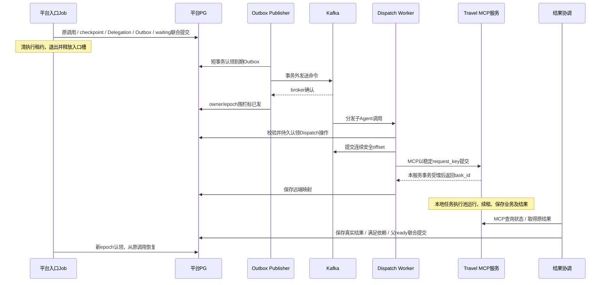

# MQ分发、MCP接入与可靠执行协议

更新：2026-11-06。本文件为[Design](design.md)附录，仅描述当前方案；行为以[specs](specs/)为准，阅读版见[执行与可靠性](../../../docs/architecture-final/01-runtime-and-reliability.md)。尚未实现或完成产品验收。

## 1. 必须区分的对象

| 对象 | 所属服务 | 含义 |
| --- | --- | --- |
| Run | 平台 | 一次用户问题，固定总期限、活动配额和累计预算 |
| 入口Job | 平台 | 本轮入口Agent的一段可认领执行，持有自己的现场和租约 |
| Delegation | 平台 | 一次专业委派，固定参数、request_key、父调用/断点及远端Task映射 |
| Dispatch操作 | 平台 | 可靠完成MCP提交的短操作，MQ确认后仍可从PG恢复 |
| TravelTask | Travel | 专业任务的执行身份、租约/现场及最终结果，不是第二个用户Run |
| Thread | 各所属服务 | 跨Run持续的模型上下文；每份TripPlan对应独立TravelThread |
| 工具逻辑调用/物理尝试 | 实际执行服务 | 一个稳定调用可发生有限次数网络尝试，分别计账 |

## 2. 完整交接链路

用户提交先在平台接纳边界处理：同授权范围内同幂等键同参数返回原Run，不重复写用户消息；同key不同参数冲突。同会话已有非终态Run时，不同新请求返回run_conflict，waiting与故障恢复期间同样互斥。新请求不追加到旧Run，也不自动取消旧Run。



平台只经MCP操作Travel专业任务；Travel不直接写平台父Job。MQ只负责调用分发，不同时向Travel另发一份直接执行命令。父Job恢复读取平台已经可靠收集的结果，不持MCP长连接等待整个规划完成。

## 3. MQ接纳与Outbox

业务事务写入唯一Outbox后，Publisher后台轮询。首版不做Redis Pub/Sub、MCP广播或额外MQ Topic来主动唤醒Outbox。按索引读取到期记录，有界批量；积压时在容量内连续取批，无工作再等下一周期，实例可错峰。

认领不能只有SELECT，也不能持数据库行锁发网络请求：短事务SKIP LOCKED选择候选，写publisher_owner/lease_expires_at并递增publisher_epoch，提交后再发送，broker确认后按原owner/epoch及有效租约标已发。超过发布租约必须续持或放弃标记，不让旧实例覆盖新认领者。

发送成功但标记前崩溃允许重发原message_id，消费端必须幂等。业务发布资格已失效的执行消息不再发布；必要终态/审计交付应与新执行命令区分。

Kafka消费者有本地容量后，短事务核验当前Run/委派/dispatch_seq/权限/期限并持久接手，再确认连续安全offset。不等Travel完整执行结束才确认。DB不可用不确认；永久协议错误可靠记录并协调失败；旧消息/已接手消息核对后确认跳过。

确认offset后退出的恢复责任在PG持久Dispatch操作，不是Kafka未确认消息。后台需扫描未提交或提交结果未知的操作，按原身份继续MCP查询/提交。容量不足时暂停相关抓取，保持必要poll/心跳，不把长工具调用塞进Kafka接纳循环。

Kafka的Topic按分区保存追加日志，每个分区有自己的offset；同一delegation_id作key只能给出分区内顺序，不能替代dispatch_seq、幂等或业务版本判断。同group内分区分配给消费者，2分区便于2个Dispatch实例分摊，增加到更多实例不会让所有实例同时拥有这2个分区；远端已受理任务的运行并发另由Travel池控制。

建议显式控制offset确认，不能让自动确认越过尚未持久接手的消息。Producer采用broker确认及客户端幂等发送方向，精确acks/重试/客户端配置在锁定版本时核对；客户端幂等也不能消除“发出后PG标记前崩溃”造成的应用重发。单机RF/minISR=1/1只有本机集成意义，不宣称跨机器容灾或端到端exactly-once。

## 4. MCP协议与业务任务接口

MCP是协议，SDK Client嵌在平台Worker/协调进程，Server嵌在独立Travel服务。采用远端Streamable HTTP，SDK负责初始化/能力协商和JSON-RPC；服务由部署独立启动，客户端不再使用stdio启动子进程。

平台按服务地址与可信服务身份复用Client/session/HTTP连接池，不为每次任务创建新进程或把所有用户的身份混为同一业务授权。模型选择允许的能力及业务参数，程序执行真实网络调用并注入可信scope/期限；服务凭据不出现在模型参数。

业务上必须有提交、状态查询、结果取回，以及按稳定业务key找回受理结果的能力。它们由我们定义工具Schema，不是MCP自动提供的持久任务保证；首版不默认依赖实验性MCP Tasks。

### 4.1 运行契约v1

技术复核在原[领域Schema](contracts/agent-contracts.schema.json)新增以下运行定义，不改变模型填写的TravelToolArgs。远端工具只由平台适配层调用，不作为另一个可让模型任意填写可信身份的工具集合。

| MCP工具 / 定义 | 输入及返回 |
| --- | --- |
| travel_submit / TravelTaskSubmit | schema_version=1、request_key、hash_version=jcs-sha256-v1、input_hash、args；返回TravelTaskReceipt，仅表示原持久Task身份及当前状态 |
| travel_find_task / TravelTaskFind | request_key＋input_hash，在可信caller/subject范围内找原Task；不存在返回安全not_found，不代表原提交不会迟到 |
| travel_get_task / TravelTaskLookup | task_id，返回原TravelTaskReceipt及state_version；queued/running正常轮询不重复创建Task |
| travel_get_result / TravelTaskLookup | task_id，终态返回TravelTaskResult及result_version；非终态返回result_pending，不能把受理回执当工具最终结果 |

`params._meta['xiaodoubao/runtime']`携带TrustedTravelMeta：scope_id/hash、subject/conversation/source_run/delegation、source_context_epoch和固定deadline。Go SDK CallToolParams.Meta支持此传输；接收方核对认证得到的caller及control scope，不信任字段自报。scope不是凭据，Bearer key只在认证头。平台本地Job owner/epoch与Dispatch seq在自己的PG围栏核验；Travel不拿父epoch代替自己的Task执行权。

input_hash=SHA256([RFC8785/JCS](https://www.rfc-editor.org/rfc/rfc8785)编码的`{schema_version:1,args,scope:TrustedTravelMeta}`)，不含input_hash自身、传输request ID、重试号、Worker/父epoch或认证头。首次固定规范化业务输入和scope后只重传原值；拒绝重复JSON键、非有限数、不能无损表达的数值及未知字段，不能因key轮换改变caller/hash。Scope撤回不通过修改原委派参数继续执行。JCS通用编码器和标准向量必须在实施中验证，材料脚本的ASCII键/小整数夹具校验不是通用JCS实现。

TravelTaskReceipt状态为queued/running/succeeded/failed/timed_out/interrupted；TravelTaskResult只允许四种终态，包含原key/hash、稳定task_id、result_version、完成时间和原TravelCallResult。终态failed/timed_out/interrupted的call_status必须failed，并可携带真实部分结果；succeeded可对应业务partial，不混淆目标完成度。查询原Task不改变终态/次数；平台同时核对委派归属、key/hash、当前依赖及结果版本，再本地保存并授予父ready一次资格。

Travel请求体与完整响应初始上限各1,000,000字节，超过明确失败，不截断计划或证据。跨服务证据使用来源服务的受控内部读取接口，校验scope、原id/version、内容hash及来源有效性；可在接收方保存不可变校验快照和外部引用供恢复，不生成可独立修改的候选事实。平台提供相关计划读取投影与证据/记忆接口，Travel不直读其业务表；接口参数/错误及权限测试由详细计划展开。

首版不自动清理request_key映射、Task终态结果、业务回执或对应授权审计。原scope/deadline先决定提交资格，失效请求即使映射不存在也不得新建Task；既有结果只可在当前获准的只读/审计范围访问，不以旧执行scope过期为由复活业务。后续引入GC时须先给出保留窗口、去重tombstone及过期拒绝协议；不能只删唯一键让旧请求变成新任务。此选择避免在未定义恢复窗口时擅自指定TTL，不承诺永不清理其他缓存。

Kafka DispatchCommand只携带schema_version/message_id/source_run_id/delegation_id/dispatch_seq/created_at，不携Bearer或完整用户上下文；消费者按ID读取平台正式不可变委派。消息不是执行授权，旧seq/终态/到期仍在PG拒绝。样例37～43与新增反例只证明结构/局部对应关系，不证明真实授权、并发或事务。

## 5. 同key受理与并发

平台在第一次生成Delegation时产生并保存request_key，重投/超时/重启不换key、不重新生成业务参数。MCP request ID和trace ID只关联一次传输，不作为业务幂等键；新的用户业务委派才用新key。

Travel按可信调用方及授权主体限定幂等作用域，同key同hash返回原Task，同key不同hash报冲突。caller身份不随API Key轮换改变。input_hash使用版本化确定性编码覆盖固定业务参数，不含认证头、传输ID、尝试号等变化项。

服务用数据库唯一约束裁决并发，例如逻辑上UNIQUE(caller_id,subject_id,request_key)。插入成功者创建Task；冲突者读取原Task并比hash，不能用ON CONFLICT UPDATE覆盖参数或把运行状态重置。事务提交后才返回受理；后台执行池只认领持久任务，不每次RPC都起一份执行。

提交超时不代表远端没受理。已有task_id就查询原Task；没有则按key查询或同key重提。暂未查到也不能证明原请求不会稍后到达。远端queued/running时继续等待，不创建另一份规划。用户已确认：最终明确failed则收集真实失败及可用部分结果交回父Agent，不自动新建专业Task；同key仍返回原失败任务，不靠换key绕过次数限制。父已过期/终态则不能恢复。

数据库实现可用唯一约束＋INSERT ... ON CONFLICT DO NOTHING RETURNING，冲突后在READ COMMITTED下用后续语句读取原已提交行并比较hash；不是先查后无约束插入，也不使用冲突UPDATE覆盖原Task。精确列、事务隔离与清理保留协议在实施前锁定。

幂等映射和结果保留覆盖协议恢复窗口；清理后迟到请求必须有明确过期处理，不能当成从未提交过。同key只保证受理不会重复创建任务，物理执行/外部调用仍需租约、围栏、调用账和副作用幂等。

## 6. 时间窗口与租约

| 时间/身份 | 负责什么 | 是否可续长 |
| --- | --- | --- |
| global_deadline_at | 默认接纳时刻＋300秒，包含排队/等待/重试/父结果表达 | 不因挂起、恢复、续租而延长 |
| 子任务deadline | 当前专业任务的上限，不晚于祖先窗口 | 只能在全局限制内约束，不因重试重置 |
| 工具逻辑deadline | 包含全部实际尝试与退避 | 每次请求取剩余时间，不能重新给完整窗口 |
| lease_expires_at | 当前执行者的有效期 | 仅原有效owner/epoch可续，不超过任务deadline |
| not_before | 最早允许下一次调度的绝对时刻 | 同一次调度保存后不因扫描重新推后 |

时间建议用PG timestamptz，由数据库时间计算/比较。参数示例可用每5秒续租、租约20秒；实际值是配置，不把“心跳存活”当业务有进展。

认领记录owner和新lease_epoch。续租仅在running、owner/epoch一致、旧租约未过期且deadline允许时成功，保持原epoch。失去执行权或确认续租失败则停止新的有效推进；网络结果未知时只能依据最后确认租约保守处理，不能假定无限持有。

父Job保存waiting/现场/依赖/Outbox后清执行租约，退出释放槽位，不再续租；Run仍非终态并继续计时。恢复为ready后重新认领新epoch。同步等待RAG/API工具的Travel仍running、占专业槽并续租。协调器轮询只读远端状态，不替父Job或Travel续租。

后台按running租约到期查恢复候选，waiting按依赖查结果；不把waiting无租约当宕机。旧Worker恢复后不能续回过期代次，即使暂时没人接管，也须重新经过认领判断。

例如12:00:00接纳Run，总截止为12:05:00；12:00:10父Job等待并释放槽，12:02:00子结果回到平台，父重新认领后只剩180秒，而不是再获得300秒。若子结果直到12:05:01才到，只能按规则留审计，不能唤醒已超时父Run。此例不表示子Task可以一直用完父全部窗口，实际需为收集/父表达预留余量。

## 7. 三次退避及工具调用

初次执行加最多三次重试，总尝试最多四次。同一实际网络调用只有一个重试责任方，SDK/HTTP/任务恢复/MQ重投不能层层相乘。重启及换实例不清次数；记录实际尝试和未知usage，预算不凭没有响应自动退款。

```text
第一次重试：U(0,1秒)
第二次重试：U(0,2秒)
第三次重试：U(0,4秒)
```

这是full jitter，窗口是上限而非固定等待。持久调度将本次随机结果转成not_before保存一次；不每次扫描重新随机。合法Retry-After作为最小等待要求，但等待后不能落入剩余期限则提前停止。

子Agent提交的持久延迟已选定PG not_before＋Outbox轮询，到期再发Kafka。失败事务直接写带not_before的唯一Outbox；若采用单列retry操作表，扫描转换为Outbox需在同一事务CAS完成，不让两个循环各自产生新尝试。保持原request_key，不把提交重试变成创建新专业任务。

工具短重试已确定使用本地可取消timer，不走MQ、不需要Redis，继续持任务执行槽/租约，不持PG事务。恢复所需调用身份/次数/结果仍持久保存；若必须保留跨重启的原等待时刻，则保存下一次时间，而不是要求Redis接管所有工具调用。

参数/授权错误、正常空结果、能力缺失和已终态不重试；外部写结果未知先核对，不自动重放。有效流式delta已展示后断流，不把第二份调用输出透明拼接成原成功结果。现有providerhttp代码仍最多三次总尝试，改为四次留后续实施。

## 8. 巡检、熔断与状态保护

巡检覆盖全局到期Run、失权running任务、未发/发布租约过期Outbox、已接手但MCP未知提交的Dispatch、已受理远端Task、待收集父依赖及到期重试记录。全局到期可靠终结，不能重试续命；局部attempt超时/租约丢失则先核对剩余预算、次数及安全恢复点。

version用于状态CAS，必须核对旧值并检查更新行数；epoch用于拒绝旧执行者；request_key用于受理幂等；dispatch_seq用于分发资格；Task版本/generation用于结果适用性。它们不能互相替代。

Run完成与超时竞争通过同一Run行锁或CAS裁定一次合法终态，状态、最终消息和事件在本地事务一致提交。跨服务无法用SQL事务包住网络；前置检查后状态仍可能变化，发布/接纳/实际调用/业务提交/回填都要校验。不承诺立即停止已发出的远端物理计算。

熔断先沿用进程内provider/account/endpoint维度，候选60秒窗口5次暂时故障打开60秒、半开单探测、连续2成功关闭；多实例半开仍受共享资源许可。阈值是工程起点，不是实测最优。熔断等待不延长deadline，认证错/参数错/无命中不当作供应方暂时故障。

## 9. 能力依据

- [Kafka retention及日志段清理](https://kafka.apache.org/41/configuration/topic-configs/#retention.ms)、[发送超时](https://kafka.apache.org/41/configuration/producer-configs/#delivery.timeout.ms)：不能当任务TTL或完成期限；Java配置名仅用于解释，不直接当Go API。
- [Redis Pub/Sub](https://redis.io/docs/latest/develop/pubsub/)：提示可丢；[Lua](https://redis.io/docs/latest/develop/programmability/eval-intro/)：原子性范围在Redis内，不覆盖PG事务。
- [PostgreSQL SKIP LOCKED](https://www.postgresql.org/docs/17/sql-select.html)：可用于多消费者队列表分摊，仍需任务状态及恢复。
- [MCP工具与通知](https://modelcontextprotocol.io/specification/2025-11-25/server/tools)：工具/能力通知不等于消息中间件Topic广播。
