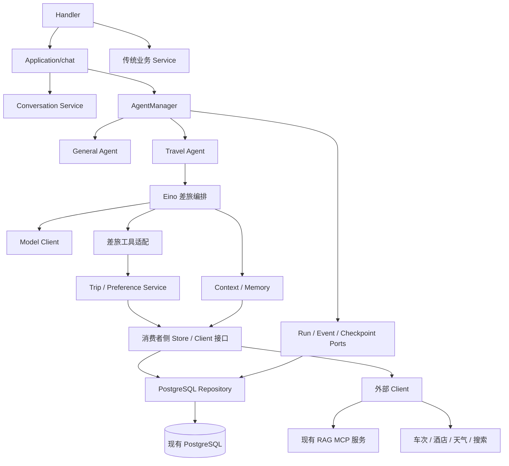

## Context

动机和范围见 [proposal.md](proposal.md)。本设计基于现有 Go 平台与 `G:\简历项目\差旅出行助手-v0\trip_assistant` 的代码检查。Python 源码的目录名虽然含 v0，但当前代码已经包含原生工具调用、TripPlan 业务校验、执行阶段、操作回执和恢复机制，不能当作一个简单聊天接口替换。

当前 Go 平台只有 general 的真实执行实现，travel 是预留入口。平台已具备 PostgreSQL、认证、会话、Run、页面租约、SSE、执行围栏和 Eino 断点适配；检查证据见 [database-check.md](database-check.md)。本次不重复创建这些基础设施。

状态：用户在查看目标目录结构后于 2026-10-23 明确要求“开始”，架构方向获准推进，并已选择本次单代理执行。详细实施计划仍需按用户给定流程交付审阅，文档存在或 CLI 显示 artifacts complete 不代表实现完成。原项目没有在本次运行测试，原 README 的历史测试数字不作为此次迁移验收。

## Goals / Non-Goals

**Goals:** 差旅能力进入现有 Go 分层；业务操作可独立测试；业务数据与执行状态分离；恢复不会重复产生业务变更；新任务不会继承被替代任务的信息。

**Non-Goals:** 不保留第二套 Python 执行服务、SQLite 身份系统或平台外 Run；现有 RAG MCP 服务是可保留的外部依赖；不实施跨任意版本的断点迁移或旧数据导入。

## Decisions

### D1. 沿用平台结构和单 Go module

```text
backend/internal/
  application/chat/             统一聊天提交及业务访问协调
  service/trip/                 行程规则、候选校验、查询协调、政策适用判断
  service/travelpreference/     差旅偏好写入、修订与来源有效性
  agent/contracts/              现有 Agent / Execution 契约
  agent/manager/                现有注册、Run、限流、暂停、恢复、事件管理
  agent/agents/general/         现有普通聊天
  agent/agents/travel/          差旅 Eino 编排与平台执行适配
  agent/memory/                 消息上下文与差旅记忆来源过滤
  agent/ports/                  执行数据存储契约，按实际需要扩展
  agenttools/travel/            Eino Tool 与业务 Service 桥接
  repository/postgres/          行程、证据、操作回执、偏好等 SQL 实现
  client/llm/                   复用现有模型连接
  client/mcp/                   现有 RAG MCP 服务的连接与协议适配
  client/train/                 车次供应方协议适配
  client/hotel/                 酒店地点信息协议适配
  client/weather/               天气供应方协议适配
  client/search/                独立网页查询，接入方核验后实现
  model/                        与 Eino 无关的平台业务类型
```

这是职责图，不预先生成全部空文件。差旅偏好有实际写入及撤回规则，使用小型 Service，不把业务写入塞进通用 memory。未来只有新增独立 HTTP 用例确实需要时才增加 application/travel，聊天入口不复制一套 Application。

沿用当前小包与消费者接口模式，不建立新的 go.mod，不把 Python 的 agents/runtime/providers/storage 目录原样复制。也不先抽象通用工作流框架；General 和 Travel 实际出现稳定共用代码后才提取共享适配。

### D2. 依赖方向与组装



图表示运行时调用；编译时 Repository 和 Client 实现消费者定义的接口，由 bootstrap 组装。Service 不 import Agent 或 Eino；Repository 不调用 Service/Agent；Handler 不使用具体 Repository；业务工具不直接写数据库。执行消息、事件和断点属于平台执行存储，通过 ports 访问 Repository，不强行绕一层 Trip Service。

Travel 实现现有 `contracts.Agent.NewExecution` 和 `contracts.Execution` 的 Start/Pause/Cancel。Manager 不知道行程如何校验；Trip Service 不创建平台 Run。Python 内部的 MainAgent 在新设计中称“差旅规划阶段”，与平台 General Agent 区分；内部规划/校验角色不会增加前端入口。

### D3. 三类状态分别归属

| 状态 | 所有者 | 含义 |
| --- | --- | --- |
| Run 状态及 attempt | AgentManager | 接受、运行、暂停、恢复、结束和失败 |
| 差旅执行阶段 | Travel 的 Eino 执行适配 | 规划、查询、校验、局部修正、受限重规划及输出 |
| TripPlan 修订和业务校验状态 | Trip Service | 已保存的行程、任务约束、候选选择、缺口与修订号 |

Run succeeded 表示本次回答与执行完成，不自动表示所有行程条件满足。没有政策证据、未知酒店价格等情况可以形成明确带缺口的结果，不得改写成合规且可预订的成功行程。

### D4. 差旅执行内核

采用平台固定的 Eino v0.9.0-beta.1，以一个可恢复的差旅执行编排承载阶段切换；模型使用原生工具调用。规划阶段负责意图、追问和全局方案，校验阶段依据已保存的结果进行选择或局部修正，业务校验由确定性的 Service 完成。

逻辑顺序：读取允许的上下文 → 必要的政策检索 → 结构化规划/修改 → 保存业务草稿 → 查询待补充项 → 证据和业务校验 → 选择或局部修正 → 必要时受限重规划 → 按持久化结果输出。缺少必要条件时追问，不伪造完整行程。独立天气、车次等查询不要求先创建 TripPlan。

不把所有行为塞入一段 Prompt，也不同时运行 Python 顶层循环和 Eino 顶层循环。先做固定版本兼容性探针，证明阶段状态、原生工具调用、停止和恢复可以一起持久化，再确定具体 ADK 组合方式。探针失败则先修订本设计，不能以普通聊天恢复成功推定差旅工作流已可恢复。

固定版本源码复核后，首选 ChatModelAgent + Handlers + TurnLoop：阶段化提示与可用工具通过 BeforeModelRewriteState 控制，模型决策通过 WrapModel 持久化，工具通过 WrapInvokableToolCall 绑定可信执行范围和稳定操作标识。阶段限制必须同时在工具/Service 执行处检查，仅隐藏模型工具列表不能作为授权。该路径复用 Eino 原生工具循环与 Checkpoint，不自行重写一个并列的 ReAct 循环。SDK 已将 Middlewares 标为弃用，新的适配优先使用 Handlers；不为展示多阶段而默认使用 SDK 明确不推荐的 Sequential/Loop Agent 全上下文转交。

先以少量非流式决策验证持久化与恢复，再接入最终回复流。模型工具参数必须完整接收、校验并保存决策后才执行业务工具，半个流不能被保存为可重放决策。共享 TurnLoop 适配仅在 Travel 与 General 同时使用时从 general 提取至 agent/einoruntime，保持 General 对外行为不变，不把 Eino 运行细节提升到 Manager 或 Service。

保留平台当前执行限制作为初始值：每个活动 attempt 120 秒，工具 10 秒，暂停 15 秒，模型迭代 8 次；暂停不占活动时限，恢复沿用平台新的活动时限，但工作流累计阶段计数不因恢复重置，不能以重复继续绕过迭代上限。任何真实依赖需要更长时限，先更新已审阅的配置和验收，不静默扩容。

### D5. 业务工具和外部查询

先迁移原有五类工具的行为：读取、独立查询、政策查询、行程写入、偏好写入。具体 Go 工具名和字段在详细计划中固定，保留类型化 schema，不兼容依赖文本 JSON 猜测路由。

用户、会话、Run、attempt 来自服务端可信执行范围，不能由模型指定。工具声明只是调用入口，业务校验和权限不能只依赖工具 schema。写操作都经 Service；Service 通过接口调用 Client 和 Repository。

Trip Service 负责多段及返程行程、日期和住宿关系、硬约束和软偏好、修改影响范围、候选绑定与版本冲突。只改活动安排时，不重新查询未变化的车次/酒店；依赖条件变化时使受影响候选失效。

查询结果统一包含状态、规范化条件、来源、获取时间、候选标识和明确的未知字段。原项目车次用聚合数据、酒店用高德地点，实际服务能力按真实返回验收。酒店地点不等于价格、库存或订单；未知价格使用空值及原因，不写成零。货币用整数最小单位或显式十进制金额类型，数据库用 NUMERIC，不用 float64 参与金额规则。

保留受限并发、相同规范化请求去重及失败分类；查询缓存必须带身份和数据范围，不跨用户泄露。只读查询可在明确错误分类下有界重试，业务写入走回执，未知结果不直接重放。原 Python DDGS 搜索依赖不直接移植；Go 可用供应方需在真实接入前核验，未接通时明确不可用。

查询初始使用每个共享 Service 最多 4 个并发请求、10 秒查询上限和 5 分钟证据有效期；模型/工具更短的父级 deadline 仍生效。规范化物理查询键不含行程绑定，以便独立与自动查询复用；返回给具体行程的证据重新持久化绑定，提交时核验当前业务修订。内存中的并发合并另外包含 Session、Run 和 attempt，避免不同执行尝试共享未经重新授权的结果。没有后台脱离执行的查询任务。

金额当前在快照内以 JSON 整数分精确保存，不使用浮点；将来需要单独的 SQL 金额统计列时使用 NUMERIC。此选择不改变金额精确和未知值的要求。

### D6. 现有 RAG MCP 服务

直接连接用户现有 RAG 系统，不在本平台创建文档索引、向量数据库或 Python RAG 内核。`client/mcp` 负责连接、调用、超时、取消及协议错误；Trip Service 负责证据来源、适用条件和业务含义，Agent 工具只负责桥接。

原 Python `providers/modular_rag.py` 使用 stdio 并验证结构化片段，这只是旧调用方式的证据。用户尚未提供实际服务，不将该 stdio 启动方式或其 schema_version=1 当作新服务已确认协议。接入时检查实际 MCP transport、工具列表、入参、鉴权和返回结构，再在边界映射为平台内部政策证据。

没有检索结果、超时、证据不适用或格式错误时标记政策未核验，不生成“符合公司政策”。保留证据文档/片段来源与版本信息，检索文本不得覆盖系统权限、执行规则或工具授权。外部服务凭据不进入日志、提示词、SSE 或断点。

### D7. 数据库扩展和事务边界

继续使用现有开发库 agent_platform 和独立测试库 agent_platform_test、pgx 和显式 SQL。现有 001–003 不修改；后续从新迁移编号追加。当前没有正式差旅表，因此数据库正常不等于差旅数据库设计已实现或验证。

以下为逻辑存储设计，最终列名及迁移文件在详细计划固定：

| 数据 | 建议表 | 关键约束 |
| --- | --- | --- |
| 行程当前版本 | travel_plans | 用户、会话、创建 Run、当前 revision；租户归属复合外键 |
| 行程修订快照 | travel_plan_revisions | (plan_id, revision) 唯一、source_run_id、结构化任务及校验结果 |
| 查询及候选证据 | travel_query_evidence | 用户、会话、Run、plan/revision 可选、query_id、result_revision、来源、时间和失效时间 |
| 已接受的工具决策批次 | travel_decisions | (run_id, decision_seq) 唯一，阶段、规范化工具参数及稳定 operation_id |
| 工具/查询执行记录 | travel_actions | 逻辑 operation_id、source Run、状态、受理 attempt、结果引用 |
| 写操作回执 | travel_operation_receipts | (user_id, run_id, operation_id) 唯一、请求摘要、目标修订和实际结果 |
| 偏好修订 | travel_preference_revisions | 用户、偏好键、值/撤回、修订号、source_run_id 和来源 |
| 派生摘要 | travel_memory_summaries | 用户、来源 Run 集合、生成版本、有效性及内容 |

行程任务初期可保存在修订快照 JSONB 中，避免一次建立大量细分表；归属、revision、操作键等一致性字段使用显式列和数据库约束，不藏在任意 JSON 文本中。查询证据与业务修订分开持久化，证据绑定候选而非只保存模型最终描述。

一次行程变更事务依次验证身份/会话、锁定 Run 并校验 attempt 与 running 状态、校验回执、锁定行程并比较 expected_revision、校验证据，最后共同提交新修订及回执。同键同参数返回原回执，同键异参数返回冲突。逻辑 operation_id 在恢复前后稳定，不包含变化的 attempt；attempt 单独承担迟到写入围栏。暂停或取消若先取得状态迁移，后来的业务提交被拒绝；业务事务若先锁定并提交，其结果必须可通过回执查询。

在执行业务工具前持久化已接受的模型决策批次与规范化参数，按 Run 和逻辑 decision_seq 识别；断点记录对应执行位置。恢复发现已有决策或回执时不重新让模型生成同一阶段的写入意图，也不因模型生成新 tool_call_id 而绕开操作幂等。决策日志、框架工具调用与回执的对应关系属于前置探针的必测范围；不能仅用“本轮工具名称 + 参数 hash”去重，因为同参数可能是用户有意执行的另一逻辑操作。

沿用平台的锁顺序：会话 → Run → 行程/偏好资源，降低与暂停、替代和完成的死锁风险。事务中不等待模型、MCP 或外部 HTTP。外部查询在事务外执行，落库时重新检查 attempt、状态和业务 revision；过期结果不得覆盖新修订。

行程保存与操作回执必须同事务；Run 完成仍使用平台既有事务。二者不是一个跨全程大事务，恢复通过回执衔接，不声称一次长任务所有中间数据都能回滚。新迁移需先在测试 schema 验证从 003 升级、失败回滚、重复运行及原平台数据保持，再考虑开发库。

### D8. 暂停与恢复

沿用平台页面归属：页面内切换继续运行；关闭发起页面触发暂停；重新打开只展示，用户手动继续。Travel 的 NewExecution 在恢复校验期间不能调用模型、供应方或写业务数据；这也适用于平台启动时 ReconcileInterrupted 的兼容性探测。

断点包含 Eino 内核状态及有版本的差旅执行状态/业务引用，保存在现有 checkpoints。兼容性指纹至少覆盖 Agent 类型、工作流版本、工具 schema 版本、模型配置和 Eino 版本；不复用 General 的指纹。避免只写一个“当前阶段”字段冒充可恢复的内核状态。

正常暂停要求执行实际停止、当前工具结果可判定、有效断点持久化成功。模型流被强制中断、断点失败或业务写入结果未知时按既有规则报告 interrupted，不显示虚假的继续能力。恢复后先核验回执、业务修订和候选时效：已成功的业务操作读回执；待执行的操作才执行；过期查询需要刷新并重新校验选择；未知写入停止并说明待核实。

持久化边界不同于外部副作用回滚。原项目没有真实订票支付，本次也不新增；不能因为当前多为本地业务写入而省略回执与恢复测试。

### D9. 新任务隔离、偏好和旧数据

用户已明确旧信息不带入本次 Go 重构：不导入 Python 的行程、偏好、历史、摘要或断点；也不删除 Python 源文件、SQLite 或现有 Go 平台数据。

对 Go 平台后续产生的数据，延续已确认行为：被新问题替代的 paused Run 被取消、断点失效，显示历史保留；该 Run 的消息、输出、工具结果、偏好和派生摘要均不进入后续自动上下文。以前已完成且未被排除的有效信息仍遵循正常预算规则。已保存业务数据不因结束执行被宣称自动撤销；不自动加载旧行程继续规划。

偏好使用带来源的修订记录，不能仅覆盖一行最终值。读取时排除来源于不再有效 Run 的修订，必要时回退到更早有效修订，避免删除一个偏好时连带抹除其他有效历史。派生摘要记录所有源 Run；任一源被排除时不得直接继续使用混合摘要，需失效并从允许来源重建。恢复原 Run 时允许恢复它自身尚有效的信息；新 Run 不能借长期记忆绕过隔离。

差旅上下文从当前平台预算策略开始，不直接套用旧 Python 的 20k-token 参数。先保证完整工具调用/结果配对及来源过滤，再实现可审计压缩和低频偏好分析；自动推断不能覆盖明确偏好或复活用户撤回的信息。这部分属于最终迁移范围，未实现前不能宣称全部重构完成。

### D10. 平台与前端接入

bootstrap 注册 travel，Handler/Application 从会话归属选择 Agent，不再硬编码拒绝 travel；可用性按 Agent 分别判断，General 未就绪不能阻断本来可用的 Travel，反之亦然。共享提交、历史、Run、SSE、暂停和恢复 API，不先复制 /travel/chat。

现有 Manager 只处理消息和工具等已知事件，增加差旅阶段展示时必须显式扩展受限事件类型和 payload 校验，再持久化及展示；不能让未知事件被静默丢弃，也不把整个模型输入或原始供应方响应直接推入 SSE。该扩展不改变 Manager 对差旅业务规则的隔离。

前端继续两个入口，切换创建新会话，历史保持原归属。差旅完成接入且依赖就绪后解除不可用提示和发送禁用；配置缺失仍明确显示原因，不调用 General 代替，也不生成假行程。政策检索暂时失败属于执行结果缺口，不能仅因一次失败删除整个 Agent 的历史或假称合规。

### D11. 同项目迁移、隔离与精简测试

按用户最新要求，直接在现有 Go 项目中重构并验证差旅能力，不另建一个完整迁移项目，也不把 Python 的上千个测试逐项翻译。功能范围仍以 specs/ 为准，减少的是重复验证和测试维护负担。

隔离分为三类：代码按现有包边界组织；运行中的用户、会话、Run 和差旅可变状态分别归属，不能共享可变上下文；数据库集成测试仅使用 agent_platform_test 的随机 schema，不向开发业务表写测试数据。隔离不要求第二个 Go module、生产数据库、进程或测试平台。

只保留能证明关键行为的测试，按以下四组收敛：

| 测试组 | 主要覆盖 | 控制重复的方式 |
| --- | --- | --- |
| 业务规则 | 日期与硬约束、局部修改、候选校验、未知金额 | 聚合为少量表驱动测试，不按每个函数或字段各建用例 |
| PostgreSQL 事务与隔离 | 用户隔离、版本冲突、写入原子性、回执幂等及 attempt 围栏 | 共用现有测试库和 schema fixture，一项规则选最能证明正确的层验证 |
| 差旅执行与恢复 | 一条完整规划链、提交后断点前中断、手动继续、新问题替代及记忆排除 | 将前置恢复探针完善为正式回归用例，不复制一套相同的工作流测试 |
| 接入及界面冒烟 | MCP 关键返回/失败、供应方适配、双入口与真实模型贯通 | 仅测新契约与变化点；沿用已有平台/UI 测试，真实依赖留少量代表性验收 |

source-assessment 的多个行为项可以映射到同一个综合用例或一组表驱动输入，矩阵条目不等于必须新增的测试函数、文件或测试套件。既有认证、历史、SSE 和通用 Run 测试继续复用，仅对差旅引入的新分支补测，不重写一遍。

不为 getter、纯透传、无行为的目录骨架或低风险文字变动新增测试，不追逐覆盖率百分比或固定数量；本次不删除既有有效测试。保留有意义的 TDD：一次业务规则或一致性变更先用对应关键用例证明失败，再实现通过。

开发时优先运行受影响包和相关用例；阶段结果满足后不机械重复全套检查。交付前统一运行现有完整回归、必要构建和 Linux race；只有新变更、失败或未解决风险才扩大或重复验证。真实模型和付费供应方调用不作为每次单测的前提。

## Risks / Trade-offs

- [直接逐文件翻译会迁入旧耦合] → 以行为矩阵及规则测试迁移，重新划分 Service、执行适配和 Client。
- [Eino 多阶段恢复与写工具组合尚未验证] → 兼容性探针是正式实现前的技术门槛，General 的验证不替代 Travel 验证。
- [业务写入与断点之间进程退出] → 业务修订和回执原子提交，恢复查回执而非盲目重放。
- [旧任务信息经偏好或摘要重新进入上下文] → 来源 Run 可追溯，过滤偏好修订，失效混合摘要，增加数据库与模型输入双重断言。
- [供应方能力不同或检索契约变化] → 边界适配、真实冒烟和明确 unavailable/partial，不用 mock 结果代替接通证据。
- [平台现有短工具时限不适合实际 MCP 延迟] → 在接入探针测量，再按已审阅的配置调整，不新增无限后台任务。
- [新迁移或索引影响已有聊天] → 测试 schema 升级和原平台回归通过后再迁移；发布前备份，优先向前修复，不以危险 down 脚本清空业务数据。

## Migration Plan

1. 本阶段提交 OpenSpec 草案、源码映射和数据库只读证据，等待审阅，不修改产品代码或数据库。
2. 技术复核后按 writing-plans 形成引用本 change 的详细实施计划，固定类型/接口、失败测试、命令和交付条件，并确认本次执行方式。
3. 先完成 Eino 差旅恢复探针与业务规则测试，收敛阶段状态和写入标识，再实现增量迁移和 Repository 事务。
4. 接入外部查询和现有 RAG MCP，完成工具、编排、断点和上下文隔离，再开放前端可用入口。
5. 完成偏好/压缩/查询韧性和源行为矩阵，按 D11 合并测试并复用平台回归，在交付前完成数据库、Go、前端及代表性真实依赖验收。阶段完成后维护 tasks.md，不能提前勾选未来任务。
6. 依流程审核任务和测试、人工核对规格；当前 OpenSpec CLI 没有 verify 命令，不声称运行了该命令。所有重要偏差解决后才归档和收尾。

## Open Questions

- 用户后续提供现有 RAG MCP 服务的位置或地址；届时核验 transport、鉴权、工具名、入参、文档来源和返回格式。可先完成 Service 的内部接口与契约测试，真实接入验收在这些信息齐备前不能完成。
- 现有车次、酒店、天气和网页搜索的可用服务与凭据在接入阶段核验；未读取或复制原 Python .env。具体供应方协议适配不得被当作已完成事项。

旧数据和被替代任务记忆的处理已按用户 2026-10-23 的最新答复收敛，不再作为待答复项。Open Questions 是连接信息核验，不授权实现者自行改变上述产品行为。
